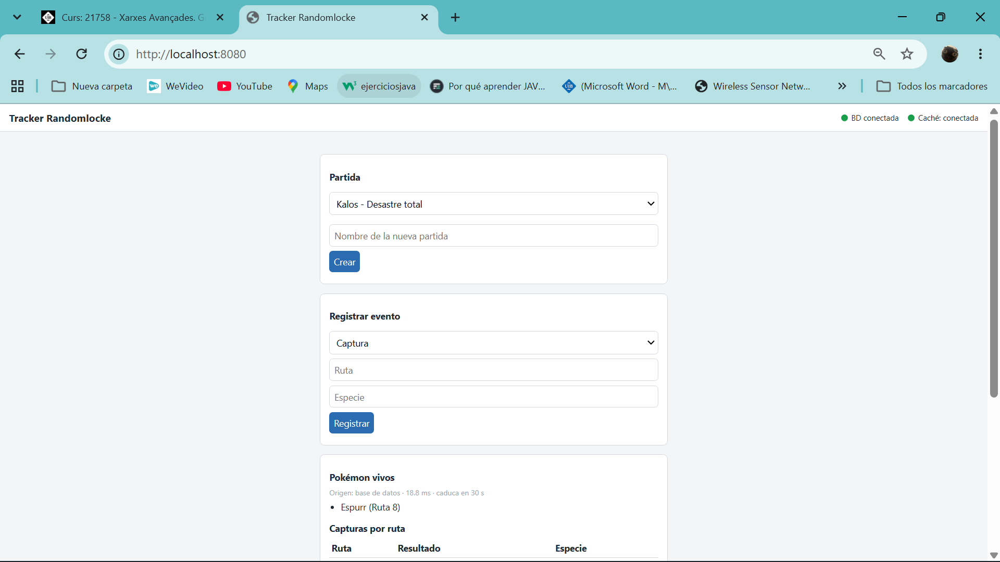
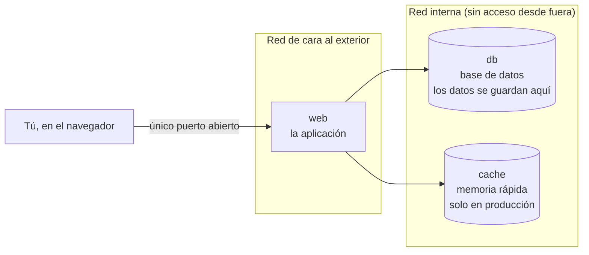
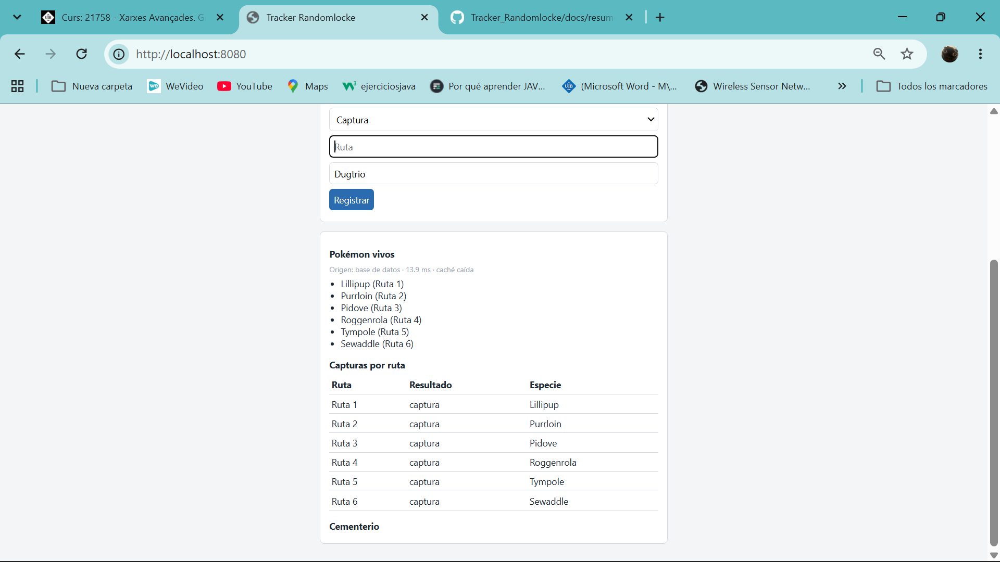
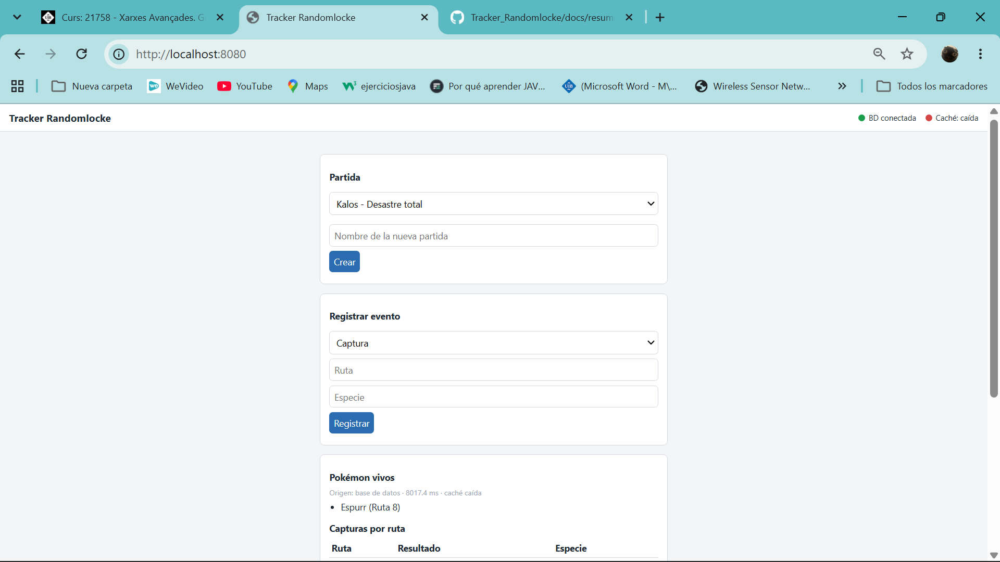
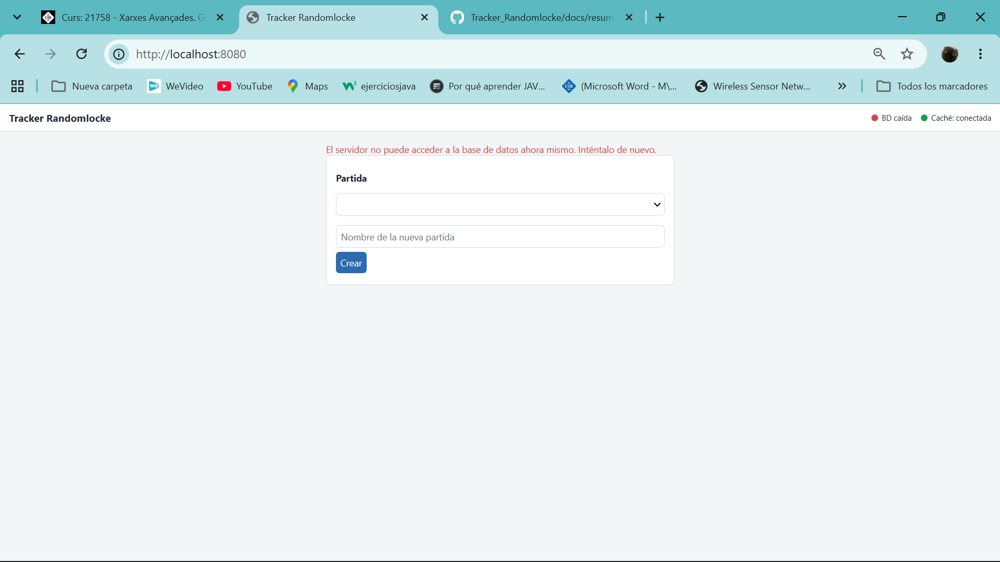

# Tracker Táctico para Randomlocke

Una web sencilla para **llevar la cuenta de una partida de Pokémon con reglas difíciles** (Nuzlocke / Randomlocke): qué Pokémon has capturado, cuáles siguen vivos y cuáles han muerto.

Es la **Práctica 1** de Xarxes Avançades (UIB): *despliegue de aplicaciones multi-entorno*. Lo importante no es la web en sí, sino **cómo se monta y se pone en marcha** con Docker: una aplicación, una base de datos y una caché que se comunican entre sí, en dos versiones (desarrollo y producción).



## Índice

1. [Probarlo en 3 minutos](#1-probarlo-en-3-minutos)
2. [Qué hace y para qué sirve](#2-qué-hace-y-para-qué-sirve)
3. [Cómo está montado](#3-cómo-está-montado)
4. [Los dos entornos: desarrollo y producción](#4-los-dos-entornos-desarrollo-y-producción)
5. [Instalación paso a paso](#5-instalación-paso-a-paso)
6. [Los comandos `make`](#6-los-comandos-make)
7. [Cómo sabemos que todo funciona](#7-cómo-sabemos-que-todo-funciona)
8. [Qué pasa si algo falla](#8-qué-pasa-si-algo-falla)
9. [Seguridad](#9-seguridad)
10. [Pruebas realizadas](#10-pruebas-realizadas)
11. [Limitaciones conocidas](#11-limitaciones-conocidas)
12. [Más documentación](#12-más-documentación)
13. [Declaración de uso de IA](#13-declaración-de-uso-de-ia)
14. [Créditos](#14-créditos)

---

## 1. Probarlo en 3 minutos

Necesitas **Docker** y **make** instalados (ver [requisitos](#requisitos)). Después:

```bash
git clone https://github.com/Akrahan/Tracker_Randomlocke.git
cd Tracker_Randomlocke
cp .env.prod.example .env.prod
sed -i "s/^POSTGRES_PASSWORD=.*/POSTGRES_PASSWORD=$(openssl rand -hex 16)/; s/^REDIS_PASSWORD=.*/REDIS_PASSWORD=$(openssl rand -hex 16)/" .env.prod
make up-prod
```

Cuando termine (unos 30 segundos), abre **http://localhost:8080** en el navegador. Para apagarlo: `make down`.

---

## 2. Qué hace y para qué sirve

### El juego, en pocas palabras

Un **Nuzlocke** es un reto que se pone uno mismo al jugar a Pokémon para hacerlo más difícil. Sus reglas básicas:

1. En cada zona (ruta) solo puedes capturar **el primer Pokémon que aparece**. Si no lo capturas, esa zona se pierde.
2. Si un Pokémon se debilita, **muere** y no se vuelve a usar.

Un **Randomlocke** añade que los Pokémon que aparecen están mezclados al azar, así que cada encuentro es una sorpresa.

El juego no apunta nada de esto: lo tiene que recordar el jugador. Por eso esta web hace de **«segunda pantalla»**: la abres en el móvil o en otra ventana mientras juegas, apuntas lo que ocurre y consultas el estado de tu partida.

### Qué puedes hacer en la web

- **Crear partidas** y **apuntar eventos**: captura, fallo (zona perdida) o muerte.
- Ver los **Pokémon vivos**, las **capturas por ruta** y el **cementerio**.
- Escribir el nombre del Pokémon con **autocompletado** (escribes «zub» y te propone «Zubat»).
- Ver en la cabecera si la **base de datos** y la **caché** están funcionando, en directo.

La web **aplica las reglas por ti**: no deja registrar dos resultados en la misma ruta, ni la muerte de un Pokémon que no has capturado.

### Qué NO hace

No se conecta al juego ni lee tus partidas guardadas (lo apuntas tú a mano), no tiene usuarios ni contraseñas, y no incluye imágenes de Pokémon (solo texto).

---

## 3. Cómo está montado

La aplicación son **tres piezas** que trabajan juntas, cada una en su propio **contenedor** (una «caja» aislada de Docker con todo lo que necesita para funcionar):

| Pieza | Qué es | Una analogía |
|---|---|---|
| **`web`** | La aplicación: la página que ves y la lógica que hay detrás | El camarero: atiende al cliente |
| **`db`** (PostgreSQL) | La base de datos, donde se guardan las partidas para siempre | El archivo: lo guarda todo, pero buscar tarda un poco |
| **`cache`** (Redis) | Una memoria rápida que guarda copias de lo que se pide mucho | La libreta del camarero: apuntes a mano para no ir al archivo cada vez |



**Idea clave de seguridad:** de las tres piezas, **solo `web` está abierta al exterior**. La base de datos y la caché viven en una red interna a la que nadie de fuera puede llegar.

### Qué es cada herramienta

- **Docker:** programa que ejecuta aplicaciones dentro de contenedores, para que funcionen igual en cualquier ordenador.
- **Docker Compose:** un fichero (`docker-compose.*.yml`) que describe **qué contenedores hay, cómo se conectan y con qué configuración**. Con un solo comando se levanta todo el conjunto.
- **Imagen:** la «receta» con la que se crea un contenedor. `web` se construye con nuestra receta (`app/Dockerfile`); la base de datos y la caché usan imágenes oficiales (`postgres:16` y `redis:7-alpine`).
- **Volumen:** un espacio de disco que Docker conserva aunque borres el contenedor. Es donde viven los datos de la base de datos, y por eso **no se pierden** al apagar y volver a encender.
- **Makefile:** un fichero con atajos (`make up-prod`...) para no tener que escribir comandos largos.

---

## 4. Los dos entornos: desarrollo y producción

La práctica pide dos versiones del mismo sistema:

- **Desarrollo (`dev`)**: para programar y probar. Más sencillo y desechable.
- **Producción (`prod`)**: la versión «de verdad». Añade la caché y más medidas de protección.

Cada una tiene **su propio fichero de configuración**, sus propios datos y su propio puerto, así que **pueden funcionar a la vez sin molestarse**.

| | Desarrollo | Producción |
|---|---|---|
| Se abre en | http://localhost:**8000** | http://localhost:**8080** |
| Piezas | `web` + `db` | `web` + `db` + `cache` |
| Caché | No tiene (la web indica «no aplica») | Sí |
| Si se apaga el ordenador | Hay que volver a encenderlo | Se recupera solo |
| Red interna aislada | No | Sí |
| Página de documentación de la API (`/docs`) | Visible | Oculta |
| Fichero de Compose | `docker-compose.dev.yml` | `docker-compose.prod.yml` |
| Fichero de configuración | `.env.dev` | `.env.prod` |

El **código es el mismo** en los dos; solo cambia la configuración.

### El fichero de configuración (`.env`)

Contiene los ajustes de cada entorno: contraseña de la base de datos, puerto, si se usa caché, etc. **Las contraseñas no están escritas en el código ni se suben a GitHub**: en el repositorio solo hay plantillas (`.env.dev.example` y `.env.prod.example`) con valores de ejemplo, y cada persona crea las suyas.

---

## 5. Instalación paso a paso

### Requisitos

- **Docker** (en Windows: Docker Desktop con WSL2) y **Docker Compose**.
- **make** y **git** (en Ubuntu/WSL: `sudo apt install make git`).
- Los puertos **8000** y **8080** libres.

Para comprobar que los tienes:

```bash
docker --version && docker compose version && make --version && git --version
```

### Pasos

**1. Descargar el proyecto**

```bash
git clone https://github.com/Akrahan/Tracker_Randomlocke.git
cd Tracker_Randomlocke
```

**2. Crear los ficheros de configuración** copiando las plantillas y poniendo contraseñas propias (estos comandos las generan al azar sin mostrarlas):

```bash
cp .env.dev.example  .env.dev
cp .env.prod.example .env.prod
sed -i "s/^POSTGRES_PASSWORD=.*/POSTGRES_PASSWORD=$(openssl rand -hex 16)/" .env.dev
sed -i "s/^POSTGRES_PASSWORD=.*/POSTGRES_PASSWORD=$(openssl rand -hex 16)/; s/^REDIS_PASSWORD=.*/REDIS_PASSWORD=$(openssl rand -hex 16)/" .env.prod
chmod 600 .env.dev .env.prod
```

**3. Encender los entornos**

```bash
make up-dev      # desarrollo
make up-prod     # producción
```

La primera vez tarda un poco porque construye y descarga las imágenes.

**4. Comprobar que está todo bien** (espera unos 20 segundos)

```bash
make ps-dev
make ps-prod
```

Todos los contenedores deben decir **`healthy`** (sano).

**5. Abrir la web**

- Producción: **http://localhost:8080**
- Desarrollo: **http://localhost:8000**
- Estado de los servicios: http://localhost:8080/status

**6. Apagar**

```bash
make down          # apaga todo y CONSERVA los datos
make clean-prod    # apaga y BORRA los datos de producción (te avisa antes)
```

### Si algo no responde

1. Mira el estado con `make ps-prod`. Si no hay contenedores, ejecuta `make up-prod`.
2. Mira los mensajes con `make logs-prod` (para salir, `Ctrl+C`).
3. Si ningún comando de Docker funciona, Docker Desktop no está arrancado.

---

## 6. Los comandos `make`

Cada comando `make` es un **atajo** a un comando largo de Docker Compose. Además garantiza que cada entorno usa **sus** ficheros y no los del otro.

### Los más usados

| Comando | Qué hace |
|---|---|
| `make up-dev` / `make up-prod` | **Enciende** el entorno (construye lo necesario y lo deja funcionando) |
| `make down` | **Apaga** desarrollo y producción. Los datos se conservan |
| `make ps-dev` / `make ps-prod` | Muestra qué está encendido y si está sano |
| `make logs-dev` / `make logs-prod` | Muestra los mensajes de la aplicación en directo |
| `make clean-dev` / `make clean-prod` | Apaga y **borra los datos**. Avisa antes. Es lo único que borra datos |

### Para probar qué pasa si algo falla (solo producción)

| Comando | Qué hace |
|---|---|
| `make stop-cache` / `make start-cache` | Apaga / enciende solo la caché |
| `make stop-db` / `make start-db` | Apaga / enciende solo la base de datos |
| `make stop-web` / `make start-web` | Apaga / enciende solo la web |
| `make psql-prod` | Comprueba la conexión con la base de datos y lista sus tablas |

### Otros

`make build-dev` / `make build-prod` (solo construir), `make down-dev` / `make down-prod` (apagar un solo entorno).

Con `make -n <comando>` ves el comando real que se ejecutaría, **sin ejecutarlo**.

---

## 7. Cómo sabemos que todo funciona

### Los «chequeos de salud» (healthchecks)

Cada contenedor tiene un **chequeo de salud**: una pequeña prueba que Docker repite cada pocos segundos para saber si el servicio está **vivo y respondiendo**, no solo encendido.

| Contenedor | Qué comprueba |
|---|---|
| `db` | Que la base de datos acepta conexiones |
| `cache` | Que la caché responde cuando se le pregunta |
| `web` | Que la propia web contesta correctamente a `/status` |

Además, la web **no se enciende hasta que la base de datos (y la caché) estén sanas**: «encendido» no significa «listo».

### La página `/status`

La web tiene una dirección, `/status`, que **pregunta de verdad** a la base de datos y a la caché y responde cómo están. La cabecera de la página usa esa información y se actualiza **cada 3 segundos, sin recargar**:

| Situación | Lo que se ve |
|---|---|
| Todo funciona | Dos círculos verdes: «BD conectada» y «Caché: conectada» |
| Desarrollo (no tiene caché) | Círculo gris: «Caché: no aplica» |
| La caché falla | Círculo rojo en la caché; **la web sigue funcionando** |
| La base de datos falla | Círculo rojo en la BD y aviso en la página |

**La caché es opcional y la base de datos es imprescindible.** Por eso, si falla la caché, la web sigue funcionando (un poco más lenta); si falla la base de datos, no puede funcionar y lo avisa.

---

## 8. Qué pasa si algo falla

### Si falla la caché (`make stop-cache`)

El círculo de la caché se pone rojo, pero **la web sigue funcionando**: pide los datos directamente a la base de datos. Solo es algo más lenta. Cuando la caché vuelve, se recupera sola.



La primera petición justo después de parar la caché puede tardar unos 8 segundos (ver [limitaciones](#11-limitaciones-conocidas)):



### Si falla la base de datos (`make stop-db`)

El círculo de la base de datos se pone rojo y la página muestra un aviso claro en lugar de romperse. Cuando la base de datos vuelve, **la página se recupera sola**, sin recargar.



### Si se borra el contenedor de la base de datos

**Los datos no se pierden**, porque viven en un volumen, no en el contenedor. Se comprobó eliminando el contenedor y recreándolo: los datos seguían ahí.

---

## 9. Seguridad

| Qué se hace | Por qué |
|---|---|
| **Ninguna contraseña en el código ni en GitHub** | Cada persona usa las suyas en su `.env` (que no se sube). Se comprobó que no hay ninguna en el historial |
| **Solo la web está abierta al exterior** | La base de datos y la caché no se pueden alcanzar desde fuera (se comprobó) |
| **Red interna en producción** | La base de datos y la caché no tienen acceso a internet ni se ven desde fuera |
| **Los programas no corren como administrador** | Si alguien lograra entrar en un contenedor, tendría pocos permisos |
| **La caché exige contraseña** | Aunque alguien llegara a ella, no podría usarla sin la clave |
| **Página de documentación oculta en producción** | No se enseña a desconocidos cómo funciona la API |
| **Los datos que escribe el usuario se tratan siempre como datos** | Evita que alguien escriba código malicioso en un campo de texto |
| **Versiones fijas** de todas las piezas | Que funcione hoy igual que mañana |

El detalle de la revisión de seguridad, con las salidas de cada comprobación, está en [`docs/pruebas.md`](docs/pruebas.md) (apartado 9).

---

## 10. Pruebas realizadas

Todas las pruebas, con sus salidas completas, están en **[`docs/pruebas.md`](docs/pruebas.md)**. Resumen:

| Qué se probó | Resultado |
|---|---|
| **Montar todo desde cero** en una carpeta nueva, sin ficheros previos | Funciona: los tres contenedores sanos |
| **Que todo está sano** y que solo la web tiene un puerto abierto | Correcto |
| **Apagar la caché** | La web sigue funcionando y lo avisa; se recupera sola |
| **Apagar la base de datos** | La web avisa y se recupera sola al volver |
| **Que los datos se conservan** al borrar el contenedor de la base de datos | Los datos siguen ahí (el contenedor es otro, el volumen es el mismo) |
| **Que la caché acelera** | La primera lectura va a la base de datos (16,8 ms); las siguientes salen de la caché (0,9 ms) |
| **Que la caché se actualiza al apuntar algo nuevo** | Sí; y si un cambio se hace «por debajo», la copia vieja caduca sola a los 30 segundos |
| **Que la caché reduce el trabajo de la base de datos** | 100 búsquedas iguales: 7 consultas con caché frente a 204 sin ella |
| **`make down`** | Apaga todo y los datos siguen ahí al volver a encender |
| **Autocompletado** | Funciona y sigue funcionando aunque se apague la caché |

---

## 11. Limitaciones conocidas

Lo que se comprobó que no es perfecto, dicho con honestidad:

- **Permisos de los ficheros `.env`:** la práctica pide que solo el propietario pueda leerlos (`chmod 600`). El desarrollo se hizo en un disco de Windows (NTFS), donde ese comando no tiene efecto. Se compensa con que esos ficheros no se suben a GitHub. En un servidor Linux se aplicaría.
- **Primera petición tras apagar la caché:** puede tardar unos 8 segundos, porque Docker Desktop tarda en darse cuenta de que el contenedor ya no existe. Después vuelve a ser inmediata.
- **La caché no se nota a simple vista:** con tan pocos datos, la diferencia de velocidad es de milisegundos. Lo que sí se demuestra es que reduce el trabajo de la base de datos.
- **«Pokémon vivos» incluye los del equipo y los guardados en la PC:** la web no distingue entre ambos, porque eso lo decide el juego.
- **Las contraseñas están en ficheros `.env`:** suficiente para esta práctica; en un entorno real se usarían sistemas específicos de gestión de secretos.
- **Sin usuarios ni autenticación.**

---

## 12. Más documentación

| Documento | Para qué sirve |
|---|---|
| [`docs/pruebas.md`](docs/pruebas.md) | Todas las pruebas y verificaciones, con sus salidas |
| [`docs/idea-y-alcance.md`](docs/idea-y-alcance.md) | Diseño y alcance del proyecto |
| [`docs/dependencias-y-pasos.md`](docs/dependencias-y-pasos.md) | Entorno y hoja de ruta por pasos |
| [`docs/diario-de-desarrollo.md`](docs/diario-de-desarrollo.md) | Qué se hizo en cada paso, con los comandos y el uso de IA |
| [`docs/conceptos-para-estudiar.md`](docs/conceptos-para-estudiar.md) | Qué es cada tecnología y por qué se eligió |
| [`docs/resumenes/`](docs/resumenes/) | Resúmenes por fase y chuleta de comandos |

### Estructura del proyecto

```
Tracker_Randomlocke/
├── app/                     # la aplicación (Dockerfile, código Python, interfaz web)
├── docker-compose.dev.yml   # el entorno de desarrollo
├── docker-compose.prod.yml  # el entorno de producción
├── .env.dev.example         # plantilla de configuración de desarrollo
├── .env.prod.example        # plantilla de configuración de producción
├── Makefile                 # los atajos (make ...)
├── docs/                    # documentación, pruebas y capturas
└── README.md
```

---

## 13. Declaración de uso de IA

La práctica exige indicar la herramienta y su versión, para qué se usó y en qué parte del trabajo:

| Herramienta y versión | Para qué se usó | En qué parte |
|---|---|---|
| **Claude Code** (Anthropic, app de escritorio), modelo **Claude Sonnet 5.5** (`claude-sonnet-5-5`) | Tutoría paso a paso y explicación de conceptos; revisión del código del alumno; en algunos pasos, aplicar cambios a petición expresa del alumno (por ejemplo, el `Makefile`, la caché de las especies o el autocompletado de la interfaz); diagnóstico de fallos con mediciones; ejecución de las pruebas; redacción de la documentación | Todas las fases: entorno, Docker y Compose, red y seguridad, aplicación, caché, interfaz, Makefile, pruebas y documentación |
| **Claude** (Anthropic), versión: *[completar]* | Valoración de la propuesta inicial frente al enunciado y redacción de los documentos de diseño | Alcance y decisiones de diseño (`docs/idea-y-alcance.md` y `docs/dependencias-y-pasos.md`) |

El detalle de qué hizo el alumno y qué hizo la IA en cada paso está en el campo **«Asistencia de IA»** de [`docs/diario-de-desarrollo.md`](docs/diario-de-desarrollo.md). Las decisiones de diseño y la comprensión del sistema son del alumno, que ha revisado y probado cada paso.

---

## 14. Créditos

- **Lista de especies:** los nombres de los Pokémon (en español) proceden del repositorio de datos de **[PokéAPI](https://github.com/PokeAPI/pokeapi)**. Se descargaron una sola vez y se guardaron en `app/species.csv`; la aplicación no consulta ninguna página externa mientras funciona.
- **Pokémon es una marca registrada** de Nintendo, Game Freak y Creatures. Este proyecto es **académico**, no está afiliado a ellas y **solo contiene texto**: no incluye imágenes ni dibujos oficiales.
