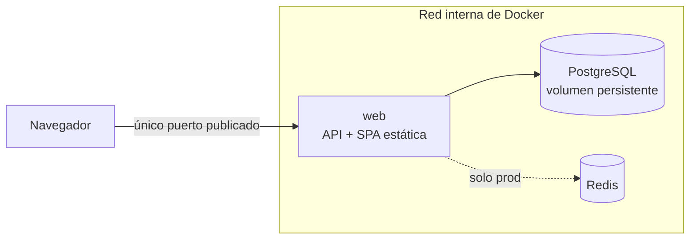

# Tracker Táctico para Randomlocke

> Documento de diseño y alcance de la Práctica 1 (Despliegue de aplicaciones multi-entorno, UIB).
> Pensado para reutilizarse en el `README.md` y en la wiki del repositorio.
>
> **Versión:** propuesta revisada el 8 de octubre de 2026.
> **Fechas clave:** entrega domingo 18 oct · test y exposición lunes 19 oct.

---

## 1. La idea

### 1.1 Resumen

Aplicación web de "segunda pantalla" para llevar el registro manual de partidas con muerte permanente (estilo Nuzlocke/Randomlocke): equipo activo, capturas por ruta y cementerio.

El valor académico no está en el dominio, sino en cómo se despliega: un servicio compuesto por **aplicación web + base de datos (PostgreSQL) + caché (Redis, solo en producción)**, orquestado con Docker Compose en dos entornos (`dev` y `prod`), con red interna, healthchecks, persistencia, seguridad básica y automatización con Makefile.

### 1.2 Contexto: qué es un Nuzlocke y un Randomlocke

Un **Nuzlocke** es un reto autoimpuesto que muchos jugadores aplican a los videojuegos de Pokémon para hacerlos más difíciles. Las reglas básicas más extendidas son:

1. Solo se puede capturar el **primer Pokémon que aparece en cada zona** (ruta). Si se huye o se debilita sin haberlo capturado, esa zona se da por perdida.
2. Si un Pokémon se debilita, se considera **muerto** y no se vuelve a usar (se libera o se aparta definitivamente).
3. Todos los Pokémon capturados reciben un mote.

Existen variantes con reglas adicionales. Por ejemplo, la **cláusula de especies**: si el primer encuentro es una especie que ya se tiene, se permite repetir el intento. Una **run** es una partida completa jugada con estas reglas.

El juego no lleva la cuenta de nada de esto: las reglas las aplica el propio jugador y es él quien debe recordar qué ha pasado.

Un **Randomlocke** combina el Nuzlocke con un *randomizer*, una herramienta que modifica el juego para aleatorizar elementos como los Pokémon que aparecen en cada zona, los equipos de los entrenadores y, según la configuración, habilidades o movimientos. El resultado es que el jugador ya no puede apoyarse en lo que sabe de la saga: cada encuentro puede traer una especie, un tipo o una combinación que no esperaba.

### 1.3 El problema

Durante una run hay que tener siempre a mano varias cosas:

- Qué Pokémon siguen vivos y en qué ruta se capturó cada uno.
- Cuáles han muerto y en qué momento.
- En qué rutas ya se ha gastado el primer encuentro.

Lo habitual es resolverlo con notas, hojas de cálculo o capturas de pantalla, lo que es fácil de equivocar y incómodo de consultar a mitad de una partida. En un Randomlocke se añade un segundo problema: para decidir bien hay que consultar datos de especies que el jugador no conoce de antemano, como sus tipos y debilidades.

### 1.4 La solución: una segunda pantalla

Una web que se abre en el móvil o en otra ventana mientras se juega, donde el jugador **registra a mano** lo que ocurre y consulta el estado de la run al instante. Es una herramienta de apoyo, no una integración con el juego.

- **MVP:** registrar la run y sus eventos (captura, fallo, muerte) y ver el equipo activo, las capturas por ruta y el cementerio.
- **"Táctico" (Fase 2):** ayudar a decidir con datos del equipo, por ejemplo qué tipos de ataque amenazan al equipo en conjunto.

### 1.5 Un uso típico

1. El jugador crea una run nueva.
2. Llega a una ruta nueva y se encuentra con un Pokémon: registra una **captura** (o un **fallo**, si no lo consigue).
3. El equipo activo y las capturas por ruta se actualizan.
4. En un combate se debilita un Pokémon: registra una **muerte**. Pasa al cementerio y deja de aparecer en el equipo activo.
5. Al volver a consultar el equipo activo, la primera petición lee de la base de datos y las siguientes salen de la caché (en `prod`), hasta que un nuevo evento la invalida.

### 1.6 Qué NO es

- No emula ni modifica el juego, ni lee las partidas guardadas.
- No incluye catálogos completos de datos oficiales ni imágenes. Pokémon es una marca de Nintendo, Game Freak y Creatures; al ser un proyecto académico, el repositorio solo debería contener texto (por ejemplo, nombres de especies) y ningún sprite oficial.
- No es multiusuario ni tiene autenticación (ver §3.3).

### 1.7 Por qué este dominio encaja con la práctica

El dominio no es un adorno: cada regla del juego se traduce en un concepto técnico que se puede defender.

| Concepto del juego | Concepto técnico | Dónde se ve |
|---|---|---|
| Muerte permanente (no se revierte) | Registro *append-only* de eventos | §5 |
| Equipo activo | Consulta derivada (capturas menos muertes), cacheada | §5, §6 |
| Cementerio | Consulta derivada de los eventos de muerte | §5 |
| Ver el equipo "al instante" en la segunda pantalla | *Cache-aside* en Redis con invalidación | §6 |
| Primer encuentro por ruta, cláusula de especies | Reglas de validación en el backend (Fase 2) | §3.2 |
| Debilidades de tipo del equipo | Función pura + tabla de tipos en CSV (Fase 2) | §3.2 |
| La herramienta debe estar disponible durante la partida | Healthchecks y `/status` | §7 |

### 1.8 Glosario

| Término | Significado |
|---|---|
| Run | Partida completa jugada con las reglas del reto |
| Ruta / zona | Área del juego; en cada una solo cuenta el primer encuentro |
| Encuentro | Aparición de un Pokémon salvaje en una zona |
| Captura / fallo | Resultado del primer encuentro: se captura o se pierde |
| Muerte (baja) | Un Pokémon se debilita y deja de poder usarse |
| Cementerio | Lista de Pokémon muertos |
| Equipo activo | Pokémon capturados que siguen vivos |
| Randomizer | Herramienta que aleatoriza elementos del juego |
| Cláusula de especies | Regla que permite repetir el encuentro si la especie ya se tiene |

## 2. Qué se cambió respecto a la propuesta inicial y por qué

La propuesta inicial estaba pensada para una rúbrica genérica ("front + back + BD + caché"). Se ajustó al enunciado real de la práctica:

| Propuesta inicial | Problema frente al enunciado | Decisión adoptada |
|---|---|---|
| Frontend SPA y backend como piezas separadas | Solo la aplicación web puede publicar un puerto; un front separado obliga a dos puertas o a un proxy extra con su healthcheck | El SPA (HTML/CSS/JS) se sirve como ficheros estáticos desde la propia API: **un contenedor `web`, un puerto publicado** |
| Caché sin distinguir entornos | La caché es **solo de producción** | La app arranca y funciona sin Redis. En `dev`, `/status` y la UI muestran la caché como "no aplica", no como "caída" |
| "Registro inmutable" pero se "registra una muerte" | Si la muerte es un `UPDATE`, el registro no es inmutable | Modelo **append-only**: `encounters` es un log de eventos y el equipo activo se **deriva** de ellos |
| Cachear el JSON del equipo activo (≈6 elementos) | Consulta minúscula: el beneficio real de la caché es marginal | Se cachea el resultado de una consulta con agregación/JOIN y la UI muestra el origen (`cache`/`db`), la latencia y el TTL restante |
| Sin requisitos transversales | Faltaban piezas que puntúan | Se incorporan `/status`, estado dinámico en la UI, healthchecks en todos los contenedores, un `.env` por entorno, Makefile y demo de persistencia |
| Fase 2 amplia y sin control | Riesgo de descarrilar el plazo de 10 días | Puertas de decisión con fechas y **una sola** funcionalidad de Fase 2 como máximo (ver §9) |

## 3. Alcance

### 3.1 MVP (obligatorio)

- **Web/API (Python, FastAPI o Flask):** registrar partidas (runs) y eventos, consultar el equipo activo y el cementerio, endpoint `/status`.
- **Interfaz:** una página que muestra el equipo activo, las capturas por ruta, el cementerio y el **estado de conexión de la BD y de la caché**, actualizado dinámicamente.
- **PostgreSQL:** tablas `runs` y `encounters`, inicialización automática, datos persistentes en volumen.
- **Redis (solo `prod`):** patrón *cache-aside* con invalidación al registrar un evento.
- **Docker Compose:** `docker-compose.dev.yml` y `docker-compose.prod.yml`, cada uno con su `.env`.
- **Automatización:** `make up-dev`, `make up-prod`, `make down` (y construcción de imágenes).

### 3.2 Fase 2 (opcional, solo si el MVP está cerrado a tiempo)

Como máximo **una** de estas funcionalidades (ver §9):

1. Informe de cobertura y debilidades del equipo (tabla de tipos 18×18 en CSV + función pura).
2. Validador de reglas de la run (cláusula de especies, primer encuentro por ruta), con respuesta `409 Conflict`.
3. Línea temporal y exportación JSON de la run.

### 3.3 Fuera de alcance

IVs, stats, habilidades, movimientos, recomendador de objetos, autenticación de usuarios, multiusuario, frameworks de front y búsqueda difusa. Quedan como **trabajo futuro**.

## 4. Arquitectura

Diferencias entre entornos:

| Aspecto | `dev` | `prod` |
|---|---|---|
| Servicios | `web`, `db` | `web`, `db`, `cache` (Redis) |
| Caché | Desactivada (la app funciona sin ella) | Activa, patrón cache-aside |
| Puertos publicados | Solo `web` | Solo `web` |
| Variables | `.env.dev` | `.env.prod` |
| Persistencia | Volumen de Postgres | Volumen de Postgres |

> **Decisión de diseño pendiente de documentar:** una red de Docker marcada como `internal: true` no permite publicar puertos. Para que `web` publique su puerto y `db`/`cache` queden inaccesibles desde fuera, una opción es usar dos redes: una normal para `web` y otra interna para `db` y `cache` (con `web` conectada a ambas).

## 5. Modelo de datos (borrador)

Modelo **append-only**: no se actualizan ni se borran filas de eventos.

- `runs`: identificador, nombre de la partida, fecha de creación.
- `encounters`: identificador, `run_id`, tipo de evento (`captura`, `muerte`, `fallo`...), ruta, especie, fecha del evento. Incluye una columna `details JSONB` reservada para la Fase 2 (habilidad, movimientos, IVs, stats), de forma que ampliar el modelo no requiera migrar.

El **equipo activo** no se guarda: se calcula como las capturas que no tienen un evento de muerte posterior. Así "registrar una muerte" es un `INSERT` más, coherente con la inmutabilidad.

> Si en la Fase 2 se separa una tabla `pokemon`, la columna `details` se mueve allí.

## 6. Estrategia de caché (Redis, solo prod)

Patrón **cache-aside**:

1. Al pedir el equipo activo, la API busca la clave en Redis (por ejemplo `team:<run_id>`).
2. Si existe (**HIT**), la devuelve. Si no (**MISS**), ejecuta la consulta en Postgres, guarda el resultado con un **TTL** y la devuelve.
3. Al registrar un evento, se hace `INSERT`, se confirma la transacción (`COMMIT`) y **después** se invalida la clave.

Puntos clave para la defensa:

- **Invalidar después del `COMMIT`:** si se invalidase antes, una lectura intermedia podría volver a cachear el estado antiguo. El TTL actúa como red de seguridad.
- **La caché guarda el resultado de una consulta con agregación/JOIN**, no una consulta trivial.
- La UI muestra `origen: cache | db`, la latencia y el TTL restante.
- **Honestidad técnica:** a esta escala el beneficio es sobre todo pedagógico; la arquitectura es la que escalaría.
- Si Redis cae, la app **degrada a Postgres** (más lenta, pero funcional) en lugar de fallar.

## 7. Healthchecks y endpoint `/status`

Todos los contenedores definen un healthcheck (en el compose o en el Dockerfile):

| Contenedor | Qué comprueba |
|---|---|
| `db` (PostgreSQL) | Que acepta conexiones (`pg_isready`) |
| `cache` (Redis, prod) | Que responde al `PING` |
| `web` | Que `/status` responde correctamente |

`/status` consulta de forma **real** (no cacheada) el estado de la BD y de la caché, y lo devuelve en JSON. La UI lo consulta periódicamente, de modo que si se detiene un servicio (`docker stop <contenedor>`) el cambio se ve **sin recargar** la página.

> **Decisión a documentar:** la caché es opcional y la BD es imprescindible. Propuesta: BD caída → `/status` responde `503`; caché caída → `200` con estado `degraded`, para que el contenedor `web` no se marque como `unhealthy` por un servicio no crítico.

## 8. Seguridad (requisitos del enunciado)

- Sin credenciales en el código ni en los YAML: todo mediante variables de entorno.
- Un fichero `.env` por entorno; en el repositorio solo se incluyen `.env.example` y se ignoran los `.env` reales (`.gitignore`).
- Solo `web` publica un puerto; `db` y `cache` accesibles únicamente desde la red interna.
- Permisos mínimos en los ficheros de configuración (por ejemplo, `chmod 600` en los `.env`).
- Contenedor de la aplicación sin privilegios de root (recomendado).

## 9. Plan de trabajo y puertas de decisión

| Fecha | Hito |
|---|---|
| 8-9 oct | **Esqueleto andante:** compose dev + API + Postgres + `/status`, aunque la app solo diga "hola" |
| 10-11 oct | Modelo de datos, endpoints del MVP e interfaz básica |
| 12 oct (festivo) | Parte de producción: Redis, compose prod, `.env.prod`, healthchecks |
| 13 oct (noche) | **Puerta 1:** MVP completo (dev + prod, healthchecks, Makefile, persistencia probada, borrador de README). Si no se cumple, la Fase 2 se cancela |
| 14-15 oct | Como máximo **una** funcionalidad de Fase 2, con límite de tiempo |
| 15 oct (noche) | **Puerta 2:** congelación de funcionalidades |
| 16-17 oct | README, diagrama, capturas de pruebas y ensayo de la defensa |
| 18 oct | Entrega (repositorio público + ZIP en el campus digital) |
| 19 oct | Test y exposición |

## 10. Riesgos

| Riesgo | Mitigación |
|---|---|
| Los datos de la Fase 2 (especies, movimientos, objetos) consumen días | Fase 2 limitada a una funcionalidad; IVs, stats y objetos quedan como trabajo futuro |
| Los scripts de `/docker-entrypoint-initdb.d` solo se ejecutan con el volumen vacío | Diseñar el esquema completo desde el inicio (`details JSONB`) y documentar el procedimiento de reinicio de volumen |
| Borrar el volumen durante el desarrollo choca con la demo de persistencia | Hacer la demo de persistencia como prueba final y documentada |
| Una dependencia externa (API de datos) añade un fallo fuera de control | No depender de APIs externas; usar datos locales (CSV) |

## 11. Verificaciones que hay que ejecutar y guardar para el README

Guardar la salida (texto o captura) de cada una:

- [ ] `make up-dev` y `make up-prod` levantan el entorno desde cero.
- [ ] `docker compose ps` muestra todos los contenedores `healthy`.
- [ ] Solo el puerto de `web` está publicado (comprobar con `docker compose ps` / `docker ps`).
- [ ] `/status` con todo operativo y con un servicio detenido (`docker stop`), y reflejo en la UI.
- [ ] Comando de prueba de conexión a la BD (por ejemplo, un `psql` dentro del contenedor).
- [ ] **Persistencia:** insertar datos, eliminar el contenedor de la BD, volver a levantarlo y comprobar que los datos siguen.
- [ ] **Caché:** demostración de MISS → HIT y de la invalidación tras registrar un evento.
- [ ] `make down` limpia el entorno.

## 12. Mapa hacia el README y la wiki

| Entregable del enunciado | De dónde sale en este documento |
|---|---|
| Introducción / descripción del proyecto (opcional pero recomendable) | §1 |
| Guía de instalación y ejecución paso a paso | Se redacta al final, a partir del Makefile (§3.1) |
| Descripción de los entornos dev y prod | §4 (tabla de diferencias) |
| Diagrama de arquitectura | §4 (Mermaid) |
| Resultados de las pruebas y verificaciones | §11 |
| Explicación de los healthchecks | §7 |
| Instrucciones de uso del Makefile | Se redacta al final |

## 13. Declaración de uso de IA (plantilla)

El enunciado exige indicar: herramienta y versión, finalidad específica y parte del trabajo. Completar con los datos reales de cada sesión.

| Herramienta y versión | Finalidad | Parte del trabajo |
|---|---|---|
| Claude (Anthropic), versión: _a verificar en la interfaz_ | Tutoría guiada paso a paso y explicación de conceptos | Planificación, arquitectura, Docker Compose, seguridad |
| Claude (Anthropic), versión: _a verificar en la interfaz_ | Evaluación crítica de la propuesta frente al enunciado | Alcance y decisiones de diseño (este documento) |
| _añadir filas según se use_ | | |
