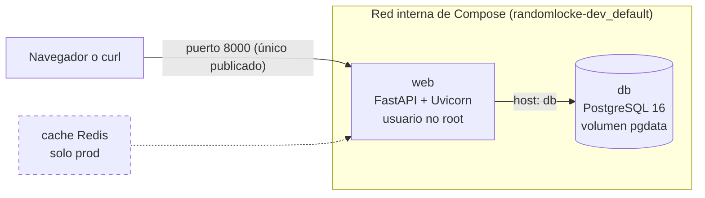

# Resumen de las Fases 0 y 1: del repositorio vacío al esqueleto andante

> Documento de repaso. El **diario** (`docs/diario-de-desarrollo.md`) cuenta qué hicimos paso a paso, y el **cuaderno** (`docs/conceptos-para-estudiar.md`) explica cada concepto. Este resumen cuenta cómo encaja todo y por qué.

## 1. Dónde estamos en una frase

Tenemos el repositorio listo y protegido, y un entorno de **desarrollo** que se levanta con `make up-dev`: una web (FastAPI) y una base de datos (PostgreSQL) en contenedores, con la web consultando la base de datos en tiempo real y todos los contenedores `healthy`. Es la **Puerta A** (esqueleto andante).

## 2. Mapa

| Ya construido | Pendiente |
|---|---|
| Repositorio, reglas y SSH | Tablas e interfaz (Fase 2) |
| `db` con volumen y healthcheck | Entorno de producción y Redis (Fase 3) |
| `web` con `/status` real y healthcheck | Revisión de seguridad, pruebas y README (Fase 4) |
| `Makefile` de dev | `make up-prod` y `make clean` |

## 3. Qué hicimos y por qué

### 3.1 Preparar el terreno: un solo entorno Linux y un repositorio con reglas

**El problema.** Trabajamos en Windows, pero los contenedores son Linux. Mezclar los dos mundos produce fallos silenciosos, sobre todo con los **finales de línea**: Windows termina las líneas con CRLF y Linux con LF, y un `Makefile` con CRLF se rompe.

**La solución.** Todo se ejecuta desde **WSL** (Ubuntu): `git`, `make` y `docker`. El repositorio se autentica con **SSH** (clave `ed25519`, la privada nunca sale de la máquina). Y antes de escribir código se crearon tres ficheros de reglas:

| Fichero | Qué controla | Cuándo actúa |
|---|---|---|
| `.gitignore` | Qué **no** se sube (los `.env`, cachés, el PDF del enunciado, `CLAUDE.md`) | Al hacer `git add` |
| `.gitattributes` | Fuerza LF al guardar y sacar ficheros de Git | Al hacer commit o checkout |
| `.editorconfig` | Cómo escribe el editor (LF, tabuladores en el `Makefile`) | Mientras escribes |

**La alternativa descartada.** Git en Windows con HTTPS. Funcionaba, pero obligaba a mantener dos instalaciones de Git sobre la misma carpeta y aumentaba el riesgo de CRLF.

**La idea clave:** estos ficheros son **preventivos**. Solo protegen lo que entra *después* de crearlos, por eso van los primeros. Detalle en el cuaderno: [`.gitignore`](../conceptos-para-estudiar.md#gitignore), [`.gitattributes`](../conceptos-para-estudiar.md#gitattributes-y-finales-de-línea-lf-y-crlf), [SSH](../conceptos-para-estudiar.md#autenticación-por-ssh).

### 3.2 Proteger los secretos

**El problema.** El enunciado prohíbe credenciales en el código y en los YAML. Pero la base de datos necesita usuario y contraseña.

**La solución.** Variables de entorno. En el YAML solo hay nombres (`${POSTGRES_PASSWORD}`) y Compose los sustituye leyendo `.env.dev` (*interpolación*). En el repositorio solo se sube la **plantilla** `.env.dev.example`, con valores ficticios; el `.env.dev` real está en el `.gitignore`.

**Cómo se aplicó.** `.env.dev.example` con seis variables, copiado a `.env.dev` y con una contraseña aleatoria generada con `openssl rand`.

**La alternativa descartada.** *Docker secrets* o un gestor de secretos (Vault). Es lo correcto en un entorno real, pero excesivo aquí. Se entrega el `.env` real en el ZIP, con credenciales exclusivas de este proyecto.

**La limitación honesta.** `chmod 600` no tiene efecto porque el proyecto vive en NTFS (`/mnt/c`). Se documentará en el README.

### 3.3 La base de datos: persistente, vigilada y aislada

**El problema.** Un contenedor es **desechable**: si lo borras, pierdes lo que había dentro. Y una base de datos no puede perder sus datos.

**La solución**, en el servicio `db` de `docker-compose.dev.yml`:

| Elemento | Qué resuelve |
|---|---|
| `image: postgres:16` | Versión fija: un `latest` podría cambiar de versión mayor y dejar los datos ilegibles |
| Volumen con nombre `pgdata` | Los datos viven **fuera** del contenedor y sobreviven a su borrado |
| `healthcheck` con `pg_isready` | Distingue "arrancado" de "listo para aceptar conexiones" |
| **Sin `ports`** | La BD no es accesible desde fuera |

**Detalles que merece la pena recordar:** `$${POSTGRES_USER}` con doble `$` en el healthcheck, para que lo resuelva el contenedor y no Compose; y que Postgres solo lee `POSTGRES_PASSWORD` cuando el volumen está **vacío**.

**La alternativa descartada.** Un *bind mount* (una carpeta de tu disco): en NTFS Postgres puede fallar por permisos.

### 3.4 La imagen de la web: reproducible, pequeña y sin privilegios

**El problema.** La web es código propio y hay que empaquetarlo en una imagen. Esa imagen debe salir igual hoy y dentro de un mes, no llevar secretos y no correr como root.

**La solución**, en `app/`:
- `requirements.txt` con **versiones fijas** (`fastapi==0.143.0`, `uvicorn==0.54.0`, `psycopg[binary]==3.3.6`).
- `Dockerfile` sobre `python:3.12-slim`, con las dependencias en una **capa propia antes del código**: si solo cambia `main.py`, no se reinstala nada.
- Usuario `appuser` (sin privilegios) y código **solo legible**: la app no puede modificarse a sí misma.
- `CMD` con Uvicorn en `0.0.0.0` (con `127.0.0.1` el puerto publicado no llegaría a la app).
- `.dockerignore` para que `.env`, `.git` o cachés no entren en la imagen.

**Las alternativas descartadas.** `alpine` (problemas de compatibilidad con paquetes de Python), instalar `curl` (superficie de ataque) y *multi-stage build* (no aporta nada con dependencias sin compilar).

**La prueba.** `whoami` dentro del contenedor responde `appuser`: no es root.

### 3.5 Conectar la web con la base de datos y vigilar la salud

**El problema.** Dos contenedores deben hablarse sin publicar el puerto de la BD, y el estado de la BD debe reflejarse en la web en tiempo real.

**La solución:**
- **Red y DNS de Compose.** Compose crea una red interna y cada servicio es accesible por su nombre: `web` llega a la BD con el host `db`, no con `localhost` (que dentro de `web` es la propia web).
- **`depends_on` con `service_healthy`:** `web` no arranca hasta que `db` pasa su healthcheck.
- **`/status` real:** abre una conexión nueva, ejecuta `SELECT 1` con `connect_timeout=2` y responde `200 {"db":"ok"}` o, si falla, `503 {"db":"down"}`. Al abrir una conexión por petición, **se recupera solo** cuando la BD vuelve.
- **Healthcheck de `web`:** con Python (`urllib`) consultando su propio `/status`. BD caída → `503` → `web` `unhealthy`.
- **Fallo rápido:** las variables se leen con `os.environ[...]`; si falta una, la app no arranca y el error dice cuál.

**La alternativa descartada.** Un *pool* de conexiones: más eficiente, pero hay que gestionar sus caídas.

### 3.6 Automatizar con `make`

**El problema.** Los comandos son largos (`docker compose --env-file .env.dev -f docker-compose.dev.yml up -d --build`) y es fácil equivocarse de fichero o de entorno.

**La solución.** Un `Makefile` en la **raíz** con `build`, `up-dev`, `down`, `ps` y `logs`. El comando base está en una variable. Dos cosas que recordar: las líneas de comando exigen **tabulador**, y `.PHONY` marca los targets que son acciones y no ficheros.

**Decisión 8.** `make down` **conserva el volumen**; borrar datos será `make clean` (más adelante), porque un `down` se ejecuta sin pensar y no debe poder destruir la base de datos.

## 4. Decisiones clave

| Decisión | Alternativa descartada | Motivo |
|---|---|---|
| `git`, `make` y `docker` en WSL, con SSH | Git en Windows con HTTPS | Un solo entorno Linux; menos riesgo de CRLF y de dos Git sobre la misma carpeta |
| `.env` reales fuera de Git, plantillas dentro | Subir los `.env` | Un secreto en el historial no se borra al eliminar el fichero |
| `environment` con interpolación | `env_file` | Cada servicio recibe solo las variables que necesita |
| Volumen con nombre | *Bind mount* | Permisos de NTFS; aislamiento |
| `python:3.12-slim` | `alpine` | Compatibilidad de paquetes de Python |
| Healthcheck de `web` con Python | Instalar `curl` | Menos paquetes y superficie de ataque |
| Conexión por petición en `/status` | *Pool* de conexiones | Se recupera solo y es más simple |
| BD caída → 503 | Responder siempre 200 | Un 200 falso engañaría al healthcheck |
| `make down` conserva volúmenes | `down -v` por defecto | No perder datos por accidente |

## 5. Qué demostramos y cómo

| Requisito | Prueba | Resultado |
|---|---|---|
| Comando de prueba de conexión a la BD | `docker compose exec db ... psql ... "SELECT version();"` | `PostgreSQL 16.15` |
| Solo `web` publica puerto | `docker ps` y `nc -zv localhost 5432` | `db` solo `5432/tcp`; `Connection refused` desde fuera |
| Proceso sin root | `docker run --rm <imagen> whoami` | `appuser` |
| Estado dinámico | `dc stop db` y `curl /status` | `503` y `{"db":"down"}`; con `dc start db`, `200` y `ok` sin reiniciar la web |
| Healthcheck de la web | `dc ps` con la BD parada | `web` pasa a `unhealthy` y vuelve a `healthy` |
| La BD conserva datos con `down` | `make down` y `docker volume ls` | `randomlocke-dev_pgdata` sigue existiendo |
| Todo con un comando | `make up-dev` y `make ps` | `db` y `web` `healthy` |

## 6. Tropiezos y qué aprendimos

| Qué pasó | Cómo se resolvió | Lección |
|---|---|---|
| Push rechazado: se había editado el diario en la web de GitHub | `git pull --rebase`, resolviendo el conflicto a mano | Todo se cambia en local; no usar `--force` sin ver qué hay en el remoto |
| Una contraseña real acabó en la plantilla `.env.dev.example` | Se vio antes del primer `git add` y se regeneró | Un secreto subido queda en el historial aunque se borre; revisar antes de `add` |
| El healthcheck de `db` quedó fuera del servicio | `config --quiet` lo detectó; se subió la sangría | En YAML, la sangría es la jerarquía |
| `requirements.txt` en `app/static/` y `Dockerfile` creado como carpeta | La verificación y `ls` lo mostraron | `static/` es público; comprobar con `ls -l` que un fichero es un fichero |
| Un `curl` justo tras `docker run -d` no respondió | Se esperó 3 s | "Arrancado" no es "listo": para eso existe el healthcheck |
| El target `up-dev` quedó sin receta | `cat -A` y `make -n` lo detectaron | Verificar el Makefile en seco antes de ejecutarlo |
| Docker no encontrado desde WSL | Arrancar Docker Desktop | Primera comprobación ante cualquier fallo de `docker` |

## 7. Preguntas de defensa de esta fase

1. **¿Por qué solo `web` publica un puerto y cómo lo demuestras?** Porque el enunciado lo exige y reduce la superficie de ataque. Lo demostré con `docker ps` (solo `web` tiene mapeo) y con `nc -zv localhost 5432`, que da `Connection refused`.
2. **¿Qué diferencia hay entre `depends_on` y un healthcheck?** `depends_on` decide *a quién esperar*; el healthcheck decide *cuándo está listo*. Juntos (`service_healthy`), `web` espera a que Postgres acepte conexiones. Lo vi al arrancar: `db` salió `Healthy` antes de que `web` empezara.
3. **¿Cómo se demuestra la persistencia y qué la rompería?** Con un volumen con nombre, que sobrevive a `make down`. Lo rompe `down -v`; por eso está separado en `make clean`.
4. **¿Cómo evitas credenciales en el repositorio?** Variables de entorno con interpolación, `.env` reales en el `.gitignore` y solo plantillas versionadas. En un entorno real usaría Docker secrets o un gestor de secretos.
5. **¿Por qué no usas `latest`?** Porque puede cambiar sin avisar; en una BD, una actualización de versión mayor puede dejar los datos ilegibles.
6. **¿Qué pasa si la BD cae?** `/status` responde `503`, la web sigue viva y el healthcheck de `web` pasa a `unhealthy`; cuando la BD vuelve, `/status` se recupera sin reiniciar nada.
7. **¿Por qué `db` y no `localhost` para llegar a la BD?** Cada contenedor tiene su propia red; dentro de `web`, `localhost` es la propia `web`. El DNS de Compose resuelve el nombre del servicio.

## 8. Qué viene ahora

**Fase 2 (MVP en dev):** tablas `runs` y `encounters`, inicialización automática, los endpoints del MVP, la interfaz estática con el indicador de estado y la **prueba de persistencia con datos reales** (insertar, borrar el contenedor y comprobar que siguen). Ahí se practica también, si hay tiempo, la rama de la funcionalidad opcional.

Primer paso: **2.1, esquema e inicialización automática**, con la decisión 5 pendiente (scripts de `initdb.d` o SQL idempotente al arrancar la app).
