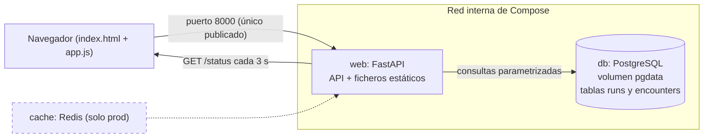

# Resumen de la Fase 2: el MVP en desarrollo

> Documento de repaso. El **diario** cuenta qué se hizo paso a paso, y el **cuaderno** (`docs/conceptos-para-estudiar.md`) explica cada concepto. Este resumen cuenta cómo encaja todo y por qué. La Fase 0 y la 1 están en [`fase-0-1.md`](fase-0-1.md).

## 1. Dónde estamos en una frase

El entorno de **desarrollo** ya es una aplicación completa: una web que guarda partidas y eventos de un Nuzlocke en PostgreSQL, calcula los Pokémon vivos y el cementerio, y se ve en el navegador con un indicador de estado en vivo. Y está demostrado que los datos sobreviven a eliminar el contenedor de la base de datos.

## 2. Mapa

| Ya construido en la Fase 2 | Pendiente |
|---|---|
| Esquema creado por la app al arrancar | Entorno de producción y Redis (Fase 3) |
| API de partidas, eventos, vivos y cementerio | Caché *cache-aside* con invalidación |
| Interfaz con estado en vivo | Red interna aislada |
| Prueba de persistencia | `make up-prod`, `make clean` y verificación desde cero |

## 3. Qué hicimos y por qué

### 3.1 El esquema lo crea la aplicación, no la base de datos

**El problema.** Las tablas tienen que existir sin crearlas a mano. Postgres permite ejecutar scripts al crear la BD (`initdb.d`), pero **solo con el volumen vacío**: para cambiar el esquema habría que borrar el volumen y perder los datos, justo lo que queremos demostrar que no pasa.

**La solución (decisión 5, opción B).** `web` ejecuta `app/schema.sql` en cada arranque, con `CREATE TABLE IF NOT EXISTS` (*idempotente*: se puede ejecutar mil veces con el mismo resultado), con reintentos por si la BD aún no responde. Se comprobó borrando las tablas y reiniciando solo `web`: las recreó. Y cuando más adelante añadimos un índice, se aplicó **sobre el volumen ya lleno**, algo que `initdb.d` no habría permitido.

**La limitación.** `IF NOT EXISTS` no modifica tablas ya creadas; para una columna nueva haría falta un `ALTER TABLE ... ADD COLUMN IF NOT EXISTS`. Por eso `encounters` incluye `details JSONB`.

### 3.2 Un modelo *append-only* y un equipo que se calcula

**El problema.** En un Nuzlocke, una muerte no se revierte. Si «morir» fuera un `UPDATE`, el registro no sería inmutable.

**La solución.** Dos tablas, `runs` y `encounters`; los eventos (`captura`, `fallo`, `muerte`) **solo se añaden**. Los **Pokémon vivos** no se guardan: son las capturas sin una muerte posterior en su ruta (`NOT EXISTS`), y el **cementerio**, las que sí la tienen (un *self join*). La **ruta** vincula captura y muerte porque solo hay una captura por ruta. La sección se llama «Pokémon vivos» y no «Equipo» porque incluye también los de la PC.

**Reglas aplicadas en dos capas.** La API valida y responde con mensajes claros (`404`, `409`, `422`); la base de datos es la segunda línea: `NOT NULL`, `CHECK`, clave foránea y un **índice único parcial** que impide dos resultados de primer encuentro en la misma ruta aunque dos peticiones lleguen a la vez. «Una sola muerte por ruta» queda solo en la API, para no atar el esquema a una regla que podría ser configurable.

### 3.3 Seguridad en la entrada y en la salida

| Amenaza | Defensa | Prueba real |
|---|---|---|
| **Inyección SQL**: texto del usuario pegado dentro del SQL | Consultas **parametrizadas** (`%s`): los datos nunca se concatenan | Una partida llamada `x'; DROP TABLE runs; --` se guarda como texto y la tabla sigue existiendo |
| **XSS**: texto del usuario interpretado como HTML | `textContent` y `new Option`, nunca `innerHTML` | Un nombre y una especie con `` se ven literales; no se ejecutó nada |
| Datos inválidos | Pydantic en la API y restricciones en la BD | Nombre vacío → `422`; tipo `huida` → `422` |

La idea común es **tratar siempre los datos como datos, nunca como código**.

### 3.4 Una interfaz sin frameworks, servida por la propia API

**El problema.** Mostrar el estado y los datos, con un solo contenedor y un solo puerto publicado.

**La solución.** `app/static/` con HTML, CSS y JS, montado con `StaticFiles` **al final** de `main.py` (un montaje en `/` captura todo, así que las rutas de la API van antes). Al servirse desde la misma API, el origen es el mismo y **no hace falta CORS**. Un *polling* cada 3 s a `/status` pinta un círculo verde, rojo o gris. Distingue dos fallos: «BD caída» (la web responde `503` con JSON) y «sin conexión con la web» (`fetch` falla).

**Mejoras que salieron al probarla en el navegador.** Con la BD caída, un `500` sin JSON mostraba «Solicitud no válida» (engañoso): ahora se muestra «El servidor no puede acceder a la base de datos». Y al volver la BD, la página se **recupera sola** (borra el mensaje y recarga los datos) detectando la transición de «caída» a «conectada».

### 3.5 La persistencia, demostrada con datos reales

**El problema.** El enunciado pide insertar datos, eliminar el contenedor, volver a iniciarlo y verificar que se mantienen.

**La prueba.** Se creó una partida marcada (con la fecha en el nombre), se anotó el ID del contenedor, el volumen y el número de filas, se eliminó **solo el contenedor** (`docker compose rm -s -f db`, no `down -v`) y se recreó.

| | Antes | Después |
|---|---|---|
| ID del contenedor | `2335b1affc07` | `44e9376fb8b5` (nuevo) |
| Volumen | `randomlocke-dev_pgdata` | el mismo |
| Partidas y eventos | 4 y 7 | 4 y 7 |

**Contenedor distinto, datos idénticos**: viven en el volumen. Evidencia completa en `docs/pruebas.md`.

## 4. Decisiones clave

| Decisión | Alternativa descartada | Motivo |
|---|---|---|
| Esquema creado por la app, idempotente (5-B) | `initdb.d` | Funciona con volúmenes llenos y deja evolucionar el esquema sin perder datos |
| Modelo *append-only*; equipo y cementerio derivados | `UPDATE` para marcar la muerte | Una muerte es irreversible; el registro es inmutable |
| La ruta vincula captura y muerte | Columna `capture_id` | Más simple; en un Nuzlocke solo hay una captura por ruta |
| Reglas en la API **y** en la BD | Solo en la API | Una segunda línea de defensa contra fallos y peticiones simultáneas |
| Consultas parametrizadas, `textContent` | Escapar o «limpiar» el texto | Defensa estructural que no depende de acordarse de limpiar |
| Interfaz servida por la propia API | Frontend en otro puerto | Un solo origen (sin CORS), un solo contenedor y un puerto publicado |
| *Polling* cada 3 s | WebSockets o *Server-Sent Events* | Más simple y suficiente para un indicador de estado |
| Conexión nueva por petición | *Pool* de conexiones | Se recupera sola tras una caída de la BD |

## 5. Qué demostramos y cómo

| Requisito | Prueba | Resultado |
|---|---|---|
| Datos persistentes con volumen | Eliminar el contenedor `db` y recrearlo | Mismo volumen, 4 y 7 filas, Eevee intacto |
| Estado reflejado dinámicamente | `stop db` con la página abierta | Círculo rojo en unos segundos, sin recargar; verde al volver |
| Inicialización automática de la BD | `DROP TABLE` y `restart web` | Las tablas reaparecen |
| Reglas del Nuzlocke | 6 peticiones: `201`, `409`, `409`, `422`, `404`... | Códigos y mensajes correctos |
| Equipo y cementerio | Registrar una muerte | El Pokémon sale de «vivos» y entra en el cementerio |
| Seguridad de entrada y salida | Nombre con SQL y HTML maliciosos | Guardados y mostrados como texto |

## 6. Tropiezos y qué aprendimos

| Qué pasó | Cómo se resolvió | Lección |
|---|---|---|
| `Literal` sin importar en `main.py` | Se vio en la revisión antes de reconstruir | Revisar el código antes de arrancar evita ciclos de error |
| El editor mantenía una copia antigua de `main.py` (punto ● y «el contenido es más reciente») | Cerrar la pestaña sin guardar y reabrirla | Si el disco y el editor difieren, mirar si hay trabajo propio antes de pulsar Revertir |
| Un `Dockerfile` creado como carpeta y una carpeta `app;C` vacía | `ls` lo mostró | El explorador de VS Code distingue «nuevo archivo» de «nueva carpeta»; mejor `touch` desde la terminal |
| Una afirmación errónea sobre las líneas en blanco del fichero | Se comprobó en disco y se corrigió | Verificar el estado real del fichero, no recordarlo |
| `docs/pruebas.md` dado por hecho sin existir | Se comprobó con `ls` | Comprobar los ficheros desde la terminal antes de cerrar un paso |
| Una salida vacía en la prueba de persistencia | Se repitió con la BD `healthy` | «Arrancado» no es «listo»: hay que esperar al healthcheck |

## 7. Preguntas de defensa de esta fase

1. **¿Cómo demuestras la persistencia y qué la rompería?** Eliminé el contenedor de la BD (no el volumen) y lo recreé: el ID del contenedor cambió y los datos eran los mismos (4 partidas y 7 eventos). La rompería `down -v` (`make clean`), que borra el volumen; por eso está separado de `make down`.
2. **¿Por qué la base de datos se inicializa desde la app y no con `initdb.d`?** Porque `initdb.d` solo se ejecuta con el volumen vacío; con `IF NOT EXISTS` al arrancar funciona con volúmenes llenos y permite evolucionar el esquema sin borrar datos.
3. **¿Cómo evitas la inyección SQL?** Con consultas parametrizadas: el SQL y los datos viajan por separado. Lo probé creando una partida llamada `x'; DROP TABLE runs; --`: se guardó como texto.
4. **¿Qué es XSS y cómo lo evitas?** Texto del usuario interpretado como HTML. Escribo siempre con `textContent`; probé con `` y no se ejecutó.
5. **¿Por qué las reglas están en la API y en la base de datos?** La API da mensajes claros; el índice único garantiza la regla aunque dos peticiones lleguen a la vez.
6. **¿Por qué no hay una tabla de equipo y cómo se sabe quién está vivo?** Es un modelo *append-only*: una muerte es un `INSERT`; los vivos son las capturas sin muerte posterior en su ruta.
7. **¿Por qué se sirve la interfaz desde la propia API?** Mismo origen: sin CORS, un contenedor y un solo puerto publicado.
8. **¿Qué pasa si la BD cae mientras alguien usa la web?** `/status` da `503`, el indicador pasa a rojo y la interfaz avisa; al volver, se recupera sola, sin reiniciar nada.

## 8. Qué viene ahora

**Fase 3, producción:** `docker-compose.prod.yml` y `.env.prod` con **Redis** (contraseña por variable de entorno, sin puertos publicados, con healthcheck), **dos redes** (una interna para `db` y `cache`), la caché ***cache-aside*** del equipo activo con invalidación **después del commit** y TTL, y `make up-prod` y `make clean`. Cierra con la **Puerta B**: MVP completo, el 13 de octubre por la noche.

Primer paso: **3.1, `.env.prod` y `docker-compose.prod.yml`**. Las dos ideas opcionales anotadas (reglas configurables por partida y distinguir equipo y PC) quedan para la Fase 4, y solo si el MVP se cierra a tiempo.
