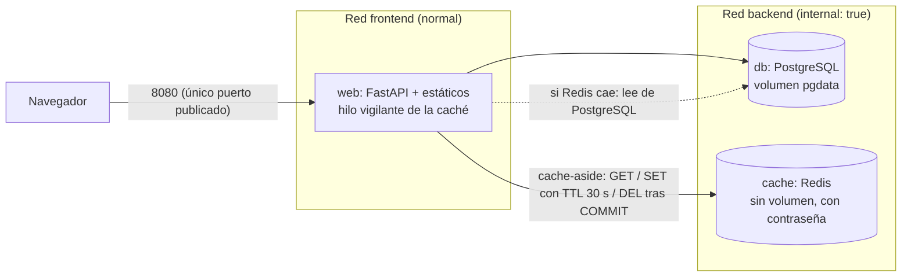

# Resumen de la Fase 3: producción, red aislada y caché

> Documento de repaso. El **diario** cuenta qué se hizo paso a paso, y el **cuaderno** (`docs/conceptos-para-estudiar.md`) explica cada concepto. Este resumen cuenta cómo encaja todo y por qué. Las fases anteriores están en [`fase-0-1.md`](fase-0-1.md) y [`fase-2.md`](fase-2.md).

## 1. Dónde estamos en una frase

El **MVP está completo**: existe un entorno de producción independiente con `web`, PostgreSQL y Redis, con la base de datos y la caché aisladas en una red interna, una caché *cache-aside* con invalidación tras el `COMMIT` que se ve en la interfaz, y un Makefile con targets por entorno, todo verificado desde un clon limpio del repositorio.

## 2. Mapa

| Ya construido en la Fase 3 | Pendiente |
|---|---|
| `docker-compose.prod.yml` y `.env.prod` | Revisión de seguridad (4.1) |
| Redes `frontend` y `backend` (`internal: true`) | Pruebas y evidencias en `docs/pruebas.md` (4.2) |
| Caché *cache-aside*, TTL, invalidación tras el commit, degradación | README final (4.3) |
| Interfaz con origen, latencia, TTL e indicador de la caché | Entrega y ensayo (4.4) |
| Makefile por entornos y verificación en limpio | Entrega y ensayo de la defensa |

## 3. Qué hicimos y por qué

### 3.1 Dos entornos, dos ficheros independientes

**El problema.** Desarrollo y producción tienen necesidades distintas: en dev no hay caché y se prueba con datos desechables; en prod hay Redis, reinicio automático y un puerto distinto.

**La solución.** Dos ficheros de Compose **independientes** (`docker-compose.dev.yml` y `.prod.yml`), cada uno con su `.env` y su `name:` (`randomlocke-dev` y `randomlocke-prod`), de modo que no comparten contenedores, redes ni volúmenes. Puertos: dev 8000, prod 8080. En prod, `restart: unless-stopped`. Detalle en el cuaderno: «Por qué existen dos entornos» y «Dos ficheros independientes».

**La alternativa descartada.** Un fichero base más un *override*: menos duplicación, pero el enunciado pide dos ficheros y así cada entorno se entiende leyendo uno solo.

### 3.2 La red interna: que la BD y la caché no sean alcanzables desde fuera

**El problema.** Solo `web` debe poder exponerse. Pero una red `internal: true` no permite publicar puertos.

**La solución.** Dos redes: `frontend` (normal) para publicar el puerto, y `backend` (`internal: true`) para `db` y `cache`. `web` está en las dos y hace de puente. Efecto añadido: `db` y `cache` no tienen salida a internet.

**La limitación.** `web` es la pieza más delicada, porque comprometerla da acceso a todo. Se mitiga con usuario sin root y credenciales solo por variables de entorno.

### 3.3 La caché: cache-aside, invalidar después del COMMIT y degradar sin romper

**El problema.** El equipo activo se calcula con una consulta; se pide a menudo y cambia poco. Se quiere servirlo rápido sin servir datos desfasados, y sin que la web dependa de Redis.

**La solución.** *Cache-aside*: `web` mira Redis (`team:<run_id>`); si no está (**MISS**) consulta PostgreSQL y guarda el resultado con un **TTL de 30 s**; si está (**HIT**) lo devuelve. Al registrar un evento se hace el `INSERT`, se confirma la transacción y **después** se borra la clave. La interfaz muestra el origen, la latencia y el TTL restante (cabeceras `X-Cache`, `X-Latency-Ms`, `X-Cache-TTL`) y un segundo indicador del estado de la caché.

**Por qué después del COMMIT.** Si se borrara antes, otra petición podría leer el dato **viejo** de la BD (la transacción aún no se confirmó) y volver a guardarlo en Redis: la caché quedaría desfasada. El TTL es solo la red de seguridad.

**Degradación.** La caché es opcional y la BD imprescindible (decisión 7): caché caída → `/status` responde `200` con `degraded` y la lectura va a PostgreSQL; BD caída → `503`.

### 3.4 El incidente que más enseñó: una caché parada tumbaba la web

Al parar Redis, `web` pasaba a `unhealthy`. Se **midió** en lugar de adivinar: `redis-py` reintenta por defecto con esperas crecientes, y los *timeouts* del cliente **no cubren la resolución DNS**, que en Docker Desktop tarda 3-8 s con un contenedor parado. Un primer arreglo (un temporizador) funcionaba a medias y se descartó al ver en el registro del healthcheck que fallaba uno de cada dos chequeos. La solución: sin reintentos (`Retry(NoBackoff(), 0)`) y **un hilo vigilante** que comprueba Redis cada 3 s y apunta el resultado en una variable (`cache_estado`); ninguna petición espera nunca a Redis. Analogía: el camarero (web) ya no comprueba la libreta (Redis) en cada cliente; un ayudante mira la libreta cada 3 s y apunta en una pizarra.

### 3.5 Automatización y verificación desde cero

**El Makefile** pasa a tener targets por entorno (`build`, `up`, `down`, `ps`, `logs`, `clean` con sufijo `-dev` o `-prod`) y un `make down` que baja los dos conservando los datos. `clean` nunca se junta: borrar datos exige elegir entorno.

**La verificación en limpio.** Se clonó el repositorio en una carpeta nueva, sin ningún `.env`, se crearon desde las plantillas con contraseñas aleatorias y se levantó prod con `COMPOSE_PROJECT_NAME=prueba-limpia` y el puerto 8081. El nombre de proyecto aparte evita reutilizar el volumen del prod real (que tiene otra contraseña) y permite no pararlo.

## 4. Decisiones clave

| Decisión | Alternativa descartada | Motivo |
|---|---|---|
| Dos ficheros de Compose independientes | Base + *override* | Lo pide el enunciado; cada entorno se lee entero |
| Dos redes, una `internal: true` | Una sola red; o publicar solo con la interna | La interna no permite publicar puertos; así `db` y `cache` quedan fuera de alcance |
| Redis sin volumen, con contraseña y sin puerto publicado | Persistir Redis | Es una copia regenerable; menos superficie |
| Invalidar tras el `COMMIT` | Antes del `COMMIT` | Evita volver a cachear el dato viejo |
| TTL de 30 s como red de seguridad | Sin TTL | Si una invalidación falla, el dato desfasado desaparece solo |
| Hilo vigilante y variable `cache_estado` | Temporizador o `ping` en cada petición | Ninguna petición espera a Redis |
| Caché caída = `200 degraded`; BD caída = `503` | Ambas `503` | La caché es opcional; no debe marcar `web` como `unhealthy` |
| Targets por entorno y `clean` separado | `down` único y `clean` conjunto | Claridad y no borrar datos por accidente |
| Verificación con `COMPOSE_PROJECT_NAME` y otro puerto | Parar el prod real | Aísla volumen y contenedores; no toca los datos reales |

## 5. Qué demostramos y cómo

| Requisito | Prueba | Resultado |
|---|---|---|
| Solo `web` publica puerto | `docker compose ps` de prod | Solo `0.0.0.0:8080->8000`; `db` y `cache` sin mapeo |
| `db` y `cache` aislados | Desde `cache`, `wget` a internet; desde `web`, conexión a `cache:6379` | `bad address` y «web alcanza cache» |
| MISS → HIT | Dos lecturas del equipo | 13,2 ms y 0,7 ms, con el TTL bajando |
| Invalidación tras el commit | Registrar una captura y leer | MISS con los datos nuevos; un `409` no invalida |
| TTL como red de seguridad | `INSERT` directo en la BD sin API | HIT con dato viejo (TTL 29); tras 32 s, MISS con el dato nuevo |
| Degradación | `docker compose stop cache` | `201` al registrar, `DEGRADED` al leer, círculo rojo, `/status` en `degraded` y `web` `healthy` |
| Reproducible desde cero | Clon limpio y `make up-prod` | Tres contenedores `healthy`, `/status` `ok`, MISS → HIT |

## 6. Tropiezos y qué aprendimos

| Qué pasó | Cómo se resolvió | Lección |
|---|---|---|
| La caché parada dejaba `web` `unhealthy` | Medir: reintentos de `redis-py` y DNS lento; hilo vigilante | Medir antes de arreglar; un servicio opcional no debe estar en el camino de las peticiones |
| Un primer arreglo «a medias» | Se vio en el registro del healthcheck que fallaba uno de cada dos chequeos | Comprobar el comportamiento sostenido, no una sola respuesta |
| La prueba del TTL con comandos manuales caducó entre pasos | Se repitió en un solo bloque | Un TTL corto exige pruebas encadenadas |
| Un borrador de interfaz con una variable global estaba mal planteado | Se rediseñó: `pedirConCabeceras` devuelve cuerpo y cabeceras | Con peticiones en paralelo, una «última respuesta» global no es fiable |
| Faltaba cambiar el `Promise.all` en `cargarRun` | Se detectó en la revisión (variable declarada dos veces) | Revisar antes de reconstruir |
| Se ejecutó la limpieza antes de crear el `.env.prod` | Falló sin consecuencias | El nombre de proyecto aísla la copia del prod real |

## 7. Preguntas de defensa de esta fase

1. **¿Por qué se invalida la caché después del COMMIT?** Si fuera antes, una lectura intermedia vería el dato viejo en la BD y lo volvería a cachear. Lo comprobé: un registro rechazado (`409`) no invalida y uno confirmado sí.
2. **¿Para qué sirve el TTL si ya invalidas?** Es la red de seguridad: cambié un dato directamente en la BD, sin pasar por la API, y la caché sirvió el dato viejo hasta que, a los 30 s, caducó.
3. **¿Qué pasa si cae Redis? ¿Y si cae PostgreSQL?** Con Redis caído la app responde igual desde PostgreSQL (`degraded`, `200`) y `web` sigue `healthy`; con PostgreSQL caído, `/status` da `503` y `web` pasa a `unhealthy`. Lo probé parando cada contenedor.
4. **¿Por qué dos redes?** Una `internal: true` no permite publicar puertos. `web` va en las dos: publica por `frontend` y habla con `db` y `cache` por `backend`, que además no sale a internet. Lo probé con `wget` desde `cache`.
5. **¿Qué diferencia hay entre `make down` y `make clean-prod`?** `down` conserva los volúmenes; `clean-prod` hace `down -v` y borra todas las partidas y eventos de prod. Por eso `clean` no se junta y avisa.
6. **¿Cómo sabes que funciona desde cero?** Clono el repo en otra carpeta sin `.env`, los creo desde las plantillas y levanto prod con otro nombre de proyecto y puerto; salen los tres contenedores `healthy` y MISS → HIT.
7. **¿Por qué tardaba tanto `/status` con Redis parado?** `redis-py` reintentaba y el DNS de Docker Desktop tarda 3-8 s en fallar con un contenedor parado; lo resolví con un hilo vigilante que escribe en una variable.
8. **¿Qué limitación tiene tu caché?** A esta escala el beneficio es sobre todo pedagógico, y se invalida con cualquier evento aunque un `fallo` no cambie el equipo (simplicidad frente a precisión).

## 8. Qué viene ahora

**Puerta B (hoy, 13 de octubre por la noche): MVP completo**, con la etiqueta sugerida `v0.2-mvp`. Después, la **Fase 4**: revisión de seguridad (4.1), pruebas y evidencias en `docs/pruebas.md` (4.2), README final (4.3) y entrega con ensayo de la defensa (4.4). Al cerrar la Fase 4 se escribirán `resumen-final.md` y `guia-de-defensa.md`.
