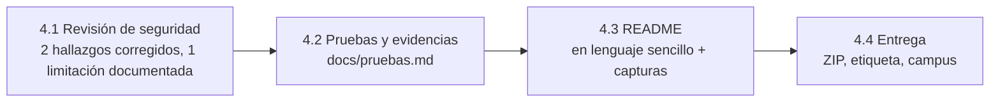

# Resumen de la Fase 4: seguridad, evidencias y documentación

> Documento de repaso. El **diario** cuenta qué se hizo paso a paso y el **cuaderno** (`docs/conceptos-para-estudiar.md`) explica cada concepto. Este resumen cuenta cómo encaja todo y por qué. Las fases anteriores están en [`fase-0-1.md`](fase-0-1.md), [`fase-2.md`](fase-2.md) y [`fase-3.md`](fase-3.md). La visión global está en [`resumen-final.md`](resumen-final.md) y las preguntas de la defensa en [`guia-de-defensa.md`](guia-de-defensa.md).

## 1. Dónde estamos en una frase

El sistema funciona, está **revisado** (seguridad), **demostrado** (pruebas con sus salidas) y **explicado** (README para cualquier lector): y **está entregado** (etiqueta `v1.0-entrega` en GitHub y ZIP subido al campus); solo queda ensayar la defensa.

## 2. Mapa

| Ya hecho en la Fase 4 | Pendiente |
|---|---|
| Revisión de seguridad con correcciones | Ensayo de la defensa con la guía y la chuleta de comandos |
| `docs/pruebas.md` con todas las verificaciones | |
| README final y capturas | |
| Chuleta de comandos y `make` para tumbar servicios | |
| Entrega: carpeta y ZIP preparados, etiqueta `v1.0-entrega` y subida al campus | |

## 3. Qué hicimos y por qué

### 3.1 Revisar la seguridad con evidencia, no de memoria

**El problema.** Decir «no hay credenciales en el repositorio» no vale: hay que comprobarlo y poder enseñarlo.

**La solución.** Una revisión con comandos de solo lectura: ficheros versionados (`git ls-files`) y su historial completo (`git log --diff-filter=A`), búsqueda de contraseñas en los ficheros versionados, puertos publicados, usuario de cada proceso (`docker top`) y qué responde la API en `/docs`.

**Qué encontró:**

| Hallazgo | Corrección |
|---|---|
| **Redis corría como `root`.** La imagen oficial solo baja de privilegios si arranca `redis-server` directamente; nuestro `command: ["sh","-c",...]` (necesario para leer la contraseña de una variable) se lo saltaba | `user: redis` en el servicio `cache`. Verificado: proceso con uid 999 |
| **`/docs`, `/redoc` y `/openapi.json` respondían en producción**, enseñando el mapa completo de la API | Variable `ENABLE_DOCS` (`false` por defecto, `true` en dev). Verificado: `404` en prod |
| Los `.env` quedaban con permisos `644` | **No se puede corregir** en NTFS montado en WSL (`chmod` no tiene efecto). Se documenta y se compensa con `.gitignore` |

**Lo que ya estaba bien y quedó demostrado:** solo las plantillas `.env.*.example` están versionadas (ahora y en todo el historial), no hay credenciales en código ni YAML (solo `${VAR}` y `os.environ`), solo `web` publica puerto.

### 3.2 Reunir las pruebas en un solo documento

**El problema.** Las verificaciones estaban repartidas por el diario y la conversación; el enunciado pide entregar los resultados.

**La solución.** `docs/pruebas.md` con la lista de verificaciones de `idea-y-alcance.md` §11, cada una con su salida real: entornos sanos y puertos, `/status` con la caché y la BD paradas, comando de conexión a la BD, **persistencia en prod** (el ID del contenedor cambia, el volumen y las filas no), caché (`MISS` → `HIT`, invalidación, TTL como red de seguridad, degradación), `make down`, verificación en limpio y seguridad. Más una tabla final que enlaza cada requisito con su sección.

**La idea importante:** la caché a esta escala no se nota en velocidad (14-16 ms frente a ~1 ms); lo que sí se **mide** es la carga que se ahorra la BD: **7 transacciones con caché frente a 204 sin ella** en 100 peticiones idénticas.

### 3.3 Un README que lea cualquiera

**El problema.** El README es el entregable principal y lo lee quien no sabe nada del proyecto.

**La solución.** La primera versión salió demasiado técnica y se reescribió en lenguaje sencillo: guion de «probarlo en 3 minutos», las tres piezas con una analogía (el camarero, el archivo y la libreta), cada herramienta explicada en una línea y el detalle técnico remitido a `docs/`. Incluye todo lo que exige el enunciado, las capturas, las limitaciones con honestidad y la declaración de uso de IA.

### 3.4 Herramientas para operar y defender

- **`make stop-cache`, `stop-db`, `stop-web` (y los `start-*`) y `make psql-prod`:** tumbar un servicio suelto o comprobar la BD con un comando, sin recordar comandos largos.
- **`docs/resumenes/chuleta-de-comandos.md`:** qué hace cada comando y guiones para las demos («levanta de cero», «tumba la caché», «demuestra la persistencia»).

### 3.5 La entrega

**El problema.** El enunciado pide un repositorio público y un archivo comprimido con todo el contenido, y esos dos no deben ser iguales: el ZIP lleva los `.env` reales (con credenciales exclusivas de este proyecto) y el repositorio no.

**La solución.** Una carpeta de entrega **fuera** del proyecto (`RedesAvanzadas/Entrega/Tracker_Randomlocke`), construida con `git archive HEAD` (exactamente lo que hay en GitHub) más los dos `.env` reales, y sin `CLAUDE.md`, sin `.git` y sin el enunciado ni material local. Se comprobó que los `.env` son idénticos a los del proyecto, que los YAML son válidos con ellos, que el `Makefile` funciona y que los enlaces del README existen. El ZIP se generó con el `tar` de Windows (formato ZIP estándar). La entrega queda identificada por la etiqueta `v1.0-entrega`, y desde fuera (sin autenticar) se comprobó que GitHub muestra el último commit y la etiqueta, y que `.env.prod`, `.env.dev` y `CLAUDE.md` devuelven `404`.

## 4. Decisiones clave

| Decisión | Alternativa descartada | Motivo |
|---|---|---|
| Revisar con comandos y guardar las salidas | Afirmar sin comprobar | Es lo que se puede enseñar en la defensa |
| `ENABLE_DOCS` seguro por defecto (`false`) | Desactivar `/docs` si hay caché | No acoplar dos decisiones distintas; si falta la variable, no hay documentación |
| Documentar la limitación de `chmod 600` | Mover el proyecto al sistema de ficheros de WSL | No compensaba a pocos días de la entrega; la compensación (ignorar `.env`) es real |
| Un único `docs/pruebas.md` | Evidencias dispersas | Un documento que enlaza requisito, prueba y resultado |
| README para cualquier lector | README técnico | El técnico ya está en `docs/` |
| Limitaciones declaradas en el README | Ocultarlas | Quien las encuentre solo las verá como defecto; contadas con honestidad son una demostración de criterio |
| `make stop-*` / `start-*` | Obligar a recordar `docker compose ... stop cache` | En la defensa es más fiable un atajo que un comando largo |

## 5. Qué demostramos y cómo

| Requisito | Prueba | Resultado |
|---|---|---|
| Sin credenciales versionadas | `git ls-files`, historial y búsqueda de contraseñas | Solo las plantillas con valores ficticios |
| Solo `web` publica puerto | `make ps-prod` y conexión TCP a 5432 y 6379 desde el host | Solo `0.0.0.0:8080->8000`; los otros dos rechazan la conexión |
| Procesos sin root | `docker top` | `web` 10001, `db` 999, `cache` 999 (tras corregirlo) |
| API no autodocumentada en prod | `curl /docs` en prod y en dev | `404` y `200` |
| Persistencia en prod | `rm -s -f db` y `up -d db` | ID del contenedor distinto (`dc80222da005` → `c4abb313400c`), mismo volumen, 4 partidas y 12 eventos antes y después |
| `/status` con servicios parados | `stop cache` y `stop db` | `200 degraded` y `503 down`, ambos con recuperación automática |
| `make down` conserva los datos | Bajar todo y volver a levantar | 5 partidas y 16 eventos intactos |
| La caché reduce consultas a la BD | 100 peticiones iguales con y sin caché | 7 frente a 204 transacciones |
| README y repositorio públicos | Comprobación sin autenticar | `200` en el repositorio; `404` en `.env.prod` y `CLAUDE.md` |

## 6. Tropiezos y qué aprendimos

| Qué pasó | Cómo se resolvió | Lección |
|---|---|---|
| Redis corría como root sin que nadie lo hubiera visto | Lo encontró la revisión (`docker top`) | Revisar el estado real; los efectos secundarios de una decisión (`sh -c`) no se ven en el YAML |
| Una prueba manual del TTL salió «mal» | El TTL (30 s) caducó entre pasos mientras se pegaban los comandos; se repitió en un solo bloque | Un TTL corto exige pruebas encadenadas |
| El README salió demasiado técnico | El alumno lo señaló y se reescribió para cualquier lector | Escribir para quien lee, no para quien escribe |
| La primera captura de «caché caída» enseña ~8 s de latencia | No se oculta: se explica (DNS de Docker Desktop) en el README | Una limitación bien contada es mejor que una captura recortada |
| Dev apareció parado tras reiniciar el equipo | Solo prod tiene `restart: unless-stopped`; `make up-dev` | Una política de reinicio es una diferencia real entre entornos |
| `chmod 600` sin efecto | Se documenta la causa (NTFS en WSL) | Saber explicar un límite es parte de la solución |

## 7. Preguntas de defensa de esta fase

1. **¿Cómo demuestras que no hay credenciales en el repositorio?** `git ls-files` muestra solo las plantillas `.env.*.example`, el historial completo (`git log --diff-filter=A`) tampoco contiene ningún `.env`, y la búsqueda de `password`/`secret`/`token` solo encuentra `${VAR}` y `os.environ`. Además, sin autenticar, `.env.prod` en GitHub devuelve `404`.
2. **¿Qué encontró tu revisión de seguridad?** Dos fallos reales: Redis corría como root (nuestro `sh -c` se saltaba la bajada de privilegios de la imagen oficial) y `/docs` estaba abierta en producción. Los corregí con `user: redis` y `ENABLE_DOCS`, y verifiqué el resultado.
3. **¿Por qué `chmod 600` no funciona en tu máquina?** Porque el proyecto está en NTFS montado en WSL sin la opción `metadata`, y `chmod` no se aplica. Lo documento; los `.env` están ignorados por Git y en un servidor Linux aplicaría `chmod 600`.
4. **¿Qué ventaja da la caché si la diferencia de velocidad no se nota?** La carga que ahorra a la BD: en 100 peticiones iguales, 7 transacciones con caché frente a 204 sin ella. Es lo que escalaría con muchos usuarios.
5. **¿Por qué `ENABLE_DOCS` vale `false` por defecto?** Seguro por defecto: si alguien olvida la variable, la documentación no se publica. En dev la activo porque ahí es útil.
6. **¿Cómo demuestras la persistencia en prod?** Anoto el ID del contenedor `db` y el número de filas, elimino solo el contenedor (`rm -s -f db`, no `down -v`) y lo recreo: el ID es otro y el volumen y las filas son los mismos.
7. **¿Qué mostrarías si te piden «tumba la caché»?** `make stop-cache`, esperar unos 12 s: `/status` da `degraded` con 200, el círculo se pone rojo y la web sigue funcionando desde PostgreSQL; `make start-cache` la recupera.

## 8. Qué viene ahora

**La práctica está entregada.** El ZIP (con los `.env` reales) está subido al campus digital y el repositorio público está etiquetado como `v1.0-entrega`. Queda **ensayar la defensa** (lunes 19 de octubre): repasar la [`guia-de-defensa.md`](guia-de-defensa.md) y practicar los guiones de la [`chuleta-de-comandos.md`](chuleta-de-comandos.md) sin mirarla (levantar de cero, tumbar la caché, la BD y la web, y demostrar la persistencia y la caché).
