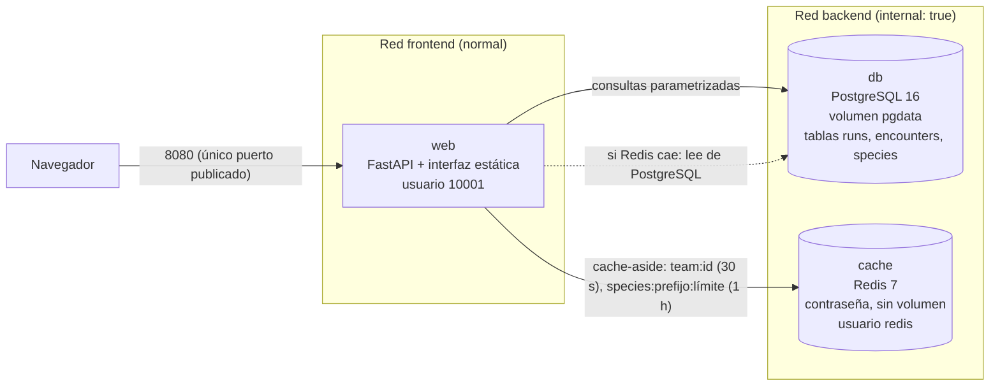

# Resumen final de la práctica: Tracker Táctico para Randomlocke

> El mapa mental de toda la práctica. Para el detalle: el **diario** (qué se hizo), el **cuaderno** (`docs/conceptos-para-estudiar.md`: qué es cada cosa), los resúmenes por fase en esta carpeta, `docs/pruebas.md` (las evidencias) y la [`guia-de-defensa.md`](guia-de-defensa.md) (preguntas probables con respuesta).

## 1. En una frase

Una web de «segunda pantalla» para llevar una partida con muerte permanente de Pokémon (FastAPI + PostgreSQL + Redis), desplegada con **Docker Compose en dos entornos independientes** (`dev` y `prod`), con red interna, healthchecks, datos persistentes, seguridad básica y un `Makefile` que lo automatiza; **probado y documentado** de principio a fin.

## 2. La arquitectura completa

### Producción (`docker-compose.prod.yml`, puerto 8080)

### Desarrollo (`docker-compose.dev.yml`, puerto 8000)

`web` + `db` en la red por defecto de Compose. **Sin caché** (`CACHE_ENABLED=false`): la web funciona igual, las lecturas van a PostgreSQL (`X-Cache: OFF`) y la interfaz indica «Caché: no aplica». Con `/docs` activada.

### Diferencias entre entornos

| | `dev` | `prod` |
|---|---|---|
| Servicios | `web`, `db` | `web`, `db`, `cache` |
| Puerto | 8000 | 8080 |
| Nombre de proyecto | `randomlocke-dev` | `randomlocke-prod` |
| Redes | por defecto | `frontend` + `backend` (`internal: true`) |
| Reinicio | no | `restart: unless-stopped` |
| `/docs` | sí | no (`ENABLE_DOCS=false`) |
| Variables | `.env.dev` | `.env.prod` |

El **código es idéntico**; solo cambia la configuración. Por eso pueden funcionar a la vez sin pisarse (nombre de proyecto y puerto distintos, volúmenes propios).

## 3. Las piezas y por qué son así

| Pieza | Qué es | Decisión clave |
|---|---|---|
| **`web`** | FastAPI + ficheros estáticos en un único contenedor | Un solo puerto publicado y mismo origen (sin CORS); imagen `python:3.12-slim`, dependencias en capa propia, usuario sin root |
| **`db`** | `postgres:16` con volumen con nombre `pgdata` | Versión fija, sin puertos, healthcheck con `pg_isready`; el esquema lo crea la aplicación al arrancar (SQL idempotente) |
| **`cache`** | `redis:7-alpine` solo en prod | Con contraseña por variable, sin puerto, sin persistencia (es regenerable), sin root |
| **Modelo de datos** | `runs`, `encounters` (*append-only*), `species` | Una muerte es un `INSERT`; los vivos y el cementerio se **derivan** (`NOT EXISTS`, *self join*) |
| **Caché** | *Cache-aside* sobre el equipo y las sugerencias de especies | Invalidar **después** del `COMMIT`; TTL como red de seguridad; si Redis cae, se lee de PostgreSQL |
| **Makefile** | Targets por entorno | `down` conserva datos; `clean-*` es el único que los borra |

## 4. El flujo de despliegue, de principio a fin

1. **Clonar** el repositorio (público): solo trae las plantillas `.env.*.example`.
2. **Crear los `.env`** copiando las plantillas y poniendo contraseñas propias.
3. **`make up-prod`** (o `up-dev`): Compose construye la imagen de `web`, crea las redes y el volumen y levanta los contenedores **en orden**: `web` espera a que `db` y `cache` estén `healthy` (`depends_on` con `service_healthy`).
4. Al arrancar, `web` **crea el esquema** si no existe y **carga la lista de especies** (1025, desde `app/species.csv`, de forma idempotente).
5. **Uso:** el navegador habla solo con `web`; la interfaz consulta `/status` cada 3 s y muestra el estado de la BD y la caché.
6. **Operación:** `make ps-prod` (salud), `make logs-prod`, `make stop-cache` / `stop-db` / `stop-web` para simular fallos.
7. **Parar:** `make down` (conserva los datos) o `make clean-prod` (los borra; avisa antes).

## 5. Seguridad

| Medida | Cómo | Evidencia |
|---|---|---|
| Sin credenciales en código ni YAML | Variables de entorno (`${VAR}`, `os.environ`) | Búsqueda de contraseñas en los ficheros versionados |
| `.env` fuera del repositorio | `.gitignore`; solo plantillas versionadas | `git ls-files`, historial completo y `404` de `.env.prod` en GitHub |
| Un único puerto publicado | Solo `web` | `make ps-prod`; 5432 y 6379 rechazan la conexión desde el host |
| Red interna | `backend` con `internal: true` | `db` y `cache` sin acceso desde fuera ni a internet |
| Procesos sin root | `web` 10001, `db` 999, `cache` 999 | `docker top` |
| Redis protegido | Contraseña obligatoria por variable | Sin puerto publicado |
| API no autodocumentada en prod | `ENABLE_DOCS=false` | `/docs` → `404` en prod, `200` en dev |
| Entrada y salida seguras | Consultas parametrizadas, escape del `LIKE`, `textContent`, Pydantic | Pruebas con `x'; DROP TABLE...`, `%` y `` |
| Versiones fijas | `python:3.12-slim`, `postgres:16`, `redis:7-alpine`, `==` en las dependencias | `Dockerfile`, `requirements.txt` |

**Límites reconocidos:** permisos `644` en los `.env` (NTFS en WSL: `chmod` no tiene efecto), credenciales en ficheros (en un entorno real, Docker secrets o un gestor), sin autenticación de usuarios.

## 6. Qué se probó (resumen; las salidas completas están en `docs/pruebas.md`)

| Requisito | Resultado |
|---|---|
| Entornos desde cero (clon limpio sin `.env`) | Tres contenedores `healthy`, `/status` ok, `MISS` → `HIT` |
| Solo `web` publica puerto y todos `healthy` | Correcto |
| `/status` con un servicio parado | Caché: `200 degraded`; BD: `503 down`; ambos se recuperan solos |
| Comando de prueba de la BD | `make psql-prod`: `SELECT 1` y las tablas |
| **Persistencia** | Contenedor `db` distinto (`dc80222da005` → `c4abb313400c`), mismo volumen y mismas filas |
| Caché | `MISS` 16,8 ms → `HIT` 0,9 ms; registrar invalida; un `409` no invalida; el TTL caduca los datos desfasados |
| Degradación | Con Redis parado: `201` al registrar, `DEGRADED` al leer |
| `make down` | Conserva los volúmenes: 5 partidas y 16 eventos intactos |
| La caché reduce consultas | 100 peticiones iguales: 7 transacciones con caché frente a 204 sin ella |
| Autocompletado | `MISS` 21,5 ms → `HIT` 1,6 ms; la lista se recarga sola tras `make clean-prod` |

## 7. Lo que aprendimos

- **Medir antes de arreglar.** La caché parada tumbaba la web: no era «un timeout» sino los reintentos de `redis-py` más una resolución DNS de 3-8 s que los *timeouts* no cubren. Se midió, se descartó un arreglo a medias y se resolvió con un hilo vigilante.
- **Lo opcional no debe estar en el camino crítico.** La caché es una optimización: su caída degrada, no rompe. Por eso la BD caída es `503` y la caché caída es `200 degraded`.
- **«Arrancado» no es «listo».** Para eso existen los healthchecks y `depends_on` con `service_healthy`.
- **Los datos viven en el volumen, no en el contenedor.** `down` conserva; `down -v` borra.
- **Los secretos que se suben, se quedan.** Un `.env` en el historial no desaparece al borrarlo: por eso `.gitignore` va primero. Una contraseña real llegó a una plantilla y se detectó antes del primer `git add`.
- **Revisar con evidencia.** La revisión de seguridad encontró dos fallos que nadie veía en el YAML (Redis como root, `/docs` abierta).
- **Ser honesto con los límites.** La caché a esta escala no se nota; lo que se mide es la carga que ahorra a la BD.

## 8. Mapa de documentos

| Documento | Contenido |
|---|---|
| `README.md` | Cómo usarlo, en lenguaje sencillo |
| `docs/pruebas.md` | Todas las pruebas con sus salidas |
| `docs/idea-y-alcance.md`, `docs/dependencias-y-pasos.md` | Diseño, alcance y hoja de ruta |
| `docs/diario-de-desarrollo.md` | Qué se hizo en cada paso (con comandos y uso de IA) |
| `docs/conceptos-para-estudiar.md` | Cuaderno de conceptos (qué es, para qué, por qué así, pregunta de defensa) |
| `docs/resumenes/fase-*.md` | Resúmenes de cada fase |
| `docs/resumenes/chuleta-de-comandos.md` | Comandos y guiones para las demos |
| `docs/resumenes/guia-de-defensa.md` | Preguntas probables con respuesta |

## 9. Estado y siguiente

La práctica está **entregada**: el trabajo técnico y documental está en GitHub (etiqueta `v1.0-entrega`) y el ZIP, con los `.env` reales, subido al campus digital. Queda ensayar la defensa (lunes 19 de octubre), apoyándose en la guía de defensa y en la chuleta de comandos.
